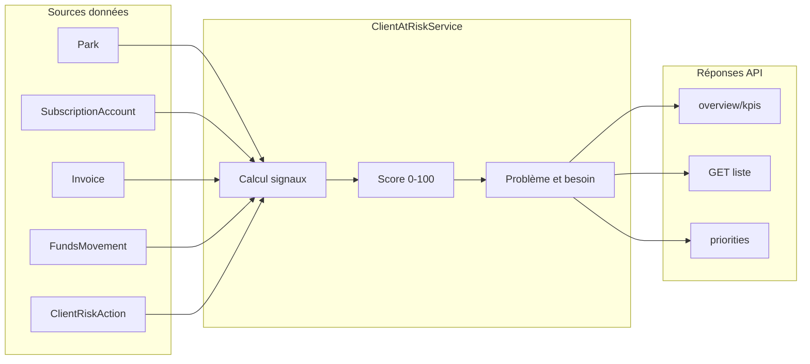
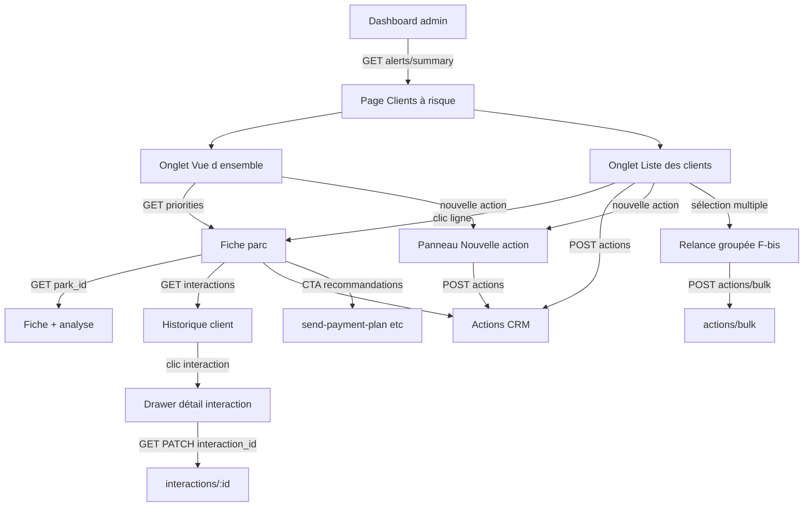

# Module admin — Clients à risque

Spécification fonctionnelle et technique pour le module **Clients à risque** de la plateforme admin VTCControl.

Ce document est la **référence unique** pour le front admin et l’implémentation API.

---

## 1. Contexte et objectif

Le module permet d’**identifier, prioriser et réactiver** les flottes (parcs) présentant un risque de churn ou nécessitant une intervention commerciale / support.

| Élément | Détail |
|---------|--------|
| **Périmètre** | Routes **admin** uniquement (profils ROOT / admin plateforme). Hors scope : technicien GPS, client final. |
| **Unité métier** | Un « client à risque » = un **parc** (`Park`) rattaché à un **compte** propriétaire (`Account`). |
| **Export** | **Aucune route API d’export.** Le front consomme les routes paginées et génère CSV / PDF / impression localement. |

---

## 2. Maquettes Figma — écrans couverts

### Écran A — Dashboard admin (alertes)

Bandeaux d’alerte en haut du dashboard principal :

- **Bandeau orange** : « X abonnements expirent dans 7 jours »
  - Aperçu des noms de flottes concernées (ex. TransportPro SA, FleetExpress, Urban Delivery)
  - Bouton **« Voir les détails »** → modale ou page liste

- **Bandeau rouge** : « X flottes sont inactives depuis 30 jours »
  - Aperçu des noms de flottes concernées
  - Bouton **« Voir les détails »**

- **Modale « Flottes inactives »**
  - Titre avec count : « Flottes inactives (3) »
  - Par ligne : nom de la flotte, **dernière activité** (date), **jours d’inactivité** (ex. « 12 jours d’inactivité »)
  - Lien **« Voir plus »** → page complète Clients à risque

### Écran B — Page « Clients à risque » / onglet Vue d’ensemble

- Fil d’Ariane : `Admin VTCControl / Clients à risque`
- Onglets : **Vue d’ensemble** | **Liste des clients**
- Bouton **« + Nouvelle action »** (coin supérieur droit)

**6 cartes KPI** (count + tendance semaine : hausse / baisse / stable) :

| Carte Figma | Description |
|-------------|-------------|
| Demandes de remise | Clients ayant demandé une remise |
| Formation requise | Clients nécessitant une session de formation |
| Difficultés financières | Clients avec impayés ou factures en retard |
| Relances en attente | Actions CRM planifiées non traitées |
| Changements d’abonnement | Upgrade, downgrade ou annulation récente |
| Opportunités de renouvellement | Abonnements arrivant à échéance prochainement |

**Table « Priorités du jour »** (top 5 par score de risque décroissant) :

| Colonne | Contenu |
|---------|---------|
| Rang | 1, 2, 3… |
| Client | Nom, ville, nombre de véhicules |
| Signal | Badge coloré : `Aucun paiement récent`, `Expiré`, `Inactif`, `Faible activité` |
| Problème | Texte explicatif (ex. « Facture impayée depuis 21 jours ») |
| Score | Valeur 0–100 + barre de progression colorée |
| Actions rapides | Icônes : téléphone, message/email, fiche détail (flèche) |

### Écran C — Onglet Liste des clients

Onglet actif **« Liste des clients »** (à côté de « Vue d’ensemble »).

**Barre d’outils (au-dessus du tableau) :**

| Élément Figma | Comportement |
|---------------|--------------|
| Recherche | Placeholder « Rechercher dans cette liste… » → query `search` |
| **Filtrer** | Ouvre panneau filtres (statut, score, plan, chargé de compte…) |
| **Grouper** | Menu : `Aucun regroupement`, `Niveau de risque`, `Cause de risque`, `Besoin client`, `Chargé de compte` → query `group_by` |
| Compteur | Ex. « 16 clients » → `totalRecords` (après filtres) dans la réponse paginée |
| Icône export | **Front uniquement** — consomme `GET /admin/clients-at-risk` paginé |
| Icône refresh | **Front uniquement** — relance le même GET |

**Colonnes du tableau (ordre Figma) :**

| # | Colonne Figma | Description | Exemples maquette |
|---|---------------|-------------|-------------------|
| 0 | **Sélection** | Case à cocher — active le mode **relance groupée** (écran F-bis) | Multi-sélection → drawer « plusieurs clients » |
| 1 | **Client** | Logo + nom + ville | Transports Kouassi, Ivoire Cargo SA, Abidjan |
| 2 | **Flotte** | Nombre de véhicules | « 42 véh. », « 96 véh. » |
| 3 | **Abonnement** | Forfait + **état abonnement** (sous-ligne ou badge) | « Elite », « Essentiel Pro », « Starter » ; « Expire dans 15j », « Expiré », « Inactif » |
| 4 | **Statut** | Badge risque coloré + icône (peut fusionner visuellement avec abonnement selon maquette) | `Aucun paiement récent`, `Expiré`, `Inactif`, `Faible activité`, `Expire bientôt` |
| 5 | **Score de risque** | Jauge circulaire 0–100 | 72 (rouge), 65–60 (orange), 50–58 (jaune) |
| 6 | **Problème principal** | Texte calculé | « Facture impayée depuis 21 jours », « Abonnement expiré il y a 8 jours », « Carte refusée deux fois » |
| 7 | **Besoins client** | Libellé court recommandé | « Échéancier », « Revue de compte », « Renouvellement », « Session de formation » |
| 8 | **Dernière activité** | Temps relatif côté front | « il y a 2j », « Hier » — API : `last_activity_at` |
| 9 | **Dernier contact** | Temps relatif côté front | « il y a 20j » — API : `last_contact_at` |
| 10 | **Prochaine action** | Titre + date | « Appeler pour facture impayée - 03 juin 2026 » |
| 11 | **Actions ligne** | Icônes | Téléphone, Message, E-mail, menu « … » |

**Vue composite liste + drawer :** la liste reste visible à gauche pendant que le panneau **Nouvelle action** (F / F-bis) s’ouvre à droite — pas de navigation full-page.

**Actions par ligne (icônes) :**

| Icône | Route API |
|-------|-----------|
| Téléphone | `POST /admin/clients-at-risk/:park_id/log-contact` `{ "type": "call" }` |
| Message | `POST .../log-contact` `{ "type": "sms" }` ou ouverture WhatsApp (front) |
| E-mail | `POST .../log-contact` `{ "type": "email" }` |
| Menu « … » | Navigation fiche détail, édition action, etc. (front) |
| Clic ligne | `GET /admin/clients-at-risk/:park_id` → écran D |

**Pagination (pied de tableau) :**

- Texte : « Affichage de 1 à 10 sur 256 entrées »
- Numéros de page (1, 2, 3… 10) + précédent / suivant
- Sélecteur « Afficher 10 entrées » → query `itemPerPage`

**Regroupement (`group_by` ≠ `none`) :** la réponse peut renvoyer des **sections** avec `group_key`, `group_label`, `items[]` au lieu d’une liste plate (voir § 5.4).

### Écran D — Fiche détail client

Fil d’Ariane : `Admin VTCControl / Clients à risque / {nom de la flotte}`

**En-tête fiche**

- Nom de la flotte (ex. « Transports Kouassi & Fils »)
- Badges : niveau de risque (ex. **Risque critique**), signal principal (ex. **Aucun paiement récent**)
- Sous-titre localisation : quartier, ville, pays (ex. « Yopougon, Abidjan - Côte d'Ivoire ») + taille flotte (ex. « 42 véhicules »)
- Bouton **« + Nouvelle action »**

**Colonne gauche — profil & risque**

| Bloc Figma | Contenu |
|------------|---------|
| **Analyse du risque** | Jauge circulaire score (ex. 72), niveau (`Critique`), **sparkline évolution 30j**, tendance (ex. « +36 points depuis les 30 derniers jours »), liste des **facteurs de risque** avec libellé + points (ex. « Aucun paiement reçu ce cycle » +20, « L'abonnement expire dans 17 jours » +40, « 2 tickets support non résolus » +12) |
| **Recommandations** | Liste d’actions suggérées avec bouton CTA chacune : « Proposer un échéancier de paiement » → **Envoyer l'échéancier** ; « Contacter sous 48 heures » → **Enregistrer une relance** ; « Planifier une revue de compte » → **Ajouter au calendrier** |
| **Contact principal** | Nom, rôle (ex. Directeur Général), téléphone, email ; boutons rapides **Appeler**, **WhatsApp**, **E-mail** |
| **Flotte** | Nombre de véhicules (ex. 42), palier tarifaire (ex. 26–100) |
| **Abonnement** | Forfait (ex. Fleet), coût annuel (ex. 4 200 000 FCFA), date de renouvellement, statut (ex. Actif) |

**Colonne droite — Historique client**

- Onglet **Interactions** (timeline chronologique)
- Bouton **Exporter** → **front uniquement** (pagination sur `GET .../interactions`)
- Types d’événements dans la timeline :
  - **Interactions manuelles** : paiement en retard, relance client — avec date, notes, tags (type contact, auteur), statut, échéance, priorité (`Urgent`)
  - **Événements système** : rappel renouvellement auto, paiement échoué — source `system`, catégorie (`Abonnement`, `Paiement`)

**Statuts d’interaction** (menu déroulant sur une action) :

| Valeur API | Libellé Figma |
|------------|---------------|
| `todo` | À faire |
| `in_progress` | En cours |
| `completed` | Terminé |
| `cancelled` | Annulé |

### Écran E — Panneau « Détails de l'interaction » (drawer)

S’ouvre au **clic sur une interaction** de la timeline (écran D). Panneau latéral superposé à la fiche client.

**En-tête drawer**

- Nom client, localisation, nb véhicules (rappel contexte)
- Mini indicateur score (jauge réduite, ex. 50)

**Champs du formulaire / consultation**

| Champ Figma | Clé API | Type | Exemple maquette |
|-------------|---------|------|------------------|
| Canal de communication | `communication_channel` | enum | `call` → libellé « Appel » |
| Motif du contact | `contact_reason` | enum + label | `payment_overdue` → badge « Paiement en retard » |
| Compte rendu de l'échange | `exchange_summary` | text | Notes détaillées de la conversation |
| Besoins identifiés | `identified_needs` | string[] | `["payment_plan"]` → tag « Échéancier de paiement » |
| Solution proposée | `proposed_solution` | text | « -15% sur renouvellement trimestriel » |
| Prochaine relance | `next_follow_up_at` | DateTime | « 05 Nov. 2023 » |
| Commercial assigné | `assigned_to` | objet Profile | Aya Koné (+ avatar) |
| Résultat | `result` | enum + label | `positive` → badge « Positif » |
| Prochaines étapes | `next_steps` | text | Actions à mener après l’échange |

**Valeurs `communication_channel` :** `call` | `whatsapp` | `email` | `in_person` | `sms` | `meeting` | `other`

**Valeurs `contact_reason` (sélection unique, grille de tags) :**

| Valeur API | Libellé Figma |
|------------|---------------|
| `payment_overdue` | Paiement en retard |
| `subscription_renewal` | Renouvellement abonnement |
| `technical_issue` | Problème technique |
| `discount_request` | Demande de remise |
| `training` | Formation |
| `billing_dispute` | Contestation facture |
| `churn_risk` | Risque de départ |
| `follow_up` | Suivi général |
| `other` | Autre |

**Valeurs `identified_needs` (multi-sélection, tags) :**

| Valeur API | Libellé Figma |
|------------|---------------|
| `payment_plan` | Échéancier de paiement |
| `loyalty_discount` | Remise fidélité |
| `training` | Session de formation |
| `technical_support` | Support technique |
| `account_review` | Revue de compte |
| `renewal` | Renouvellement |

**Valeurs `result` (dropdown obligatoire) :**

| Valeur API | Libellé Figma |
|------------|---------------|
| `positive` | Positif |
| `no_answer` | Sans réponse |
| `delay_requested` | Délai demandé |
| `awaiting_response` | En attente de réponse |
| `message_left` | Message laissé |
| `neutral` | Neutre *(optionnel)* |
| `negative` | Négatif *(optionnel)* |

**Comportement :**

- Interactions **`source=manual`** : lecture + édition (PATCH)
- Interactions **`source=system`** : lecture seule (pas de modification du compte rendu) ou drawer non ouvert côté front

**Actions drawer :** enregistrer (PATCH), fermer ; pas d’export dédié.

### Écran F — Panneau « Nouvelle action » (drawer)

S’ouvre via le bouton **« + Nouvelle action »** (liste, vue d’ensemble ou fiche détail).

**En-tête**

- Titre : **Nouvelle action**
- Sous-titre : « Créer une relance ou enregistrer une interaction »
- Bouton fermer (X)

**Onglets (mode formulaire)**

| Onglet Figma | `mode` API | Description |
|--------------|------------|-------------|
| Enregistrer une interaction | `register_interaction` | Compte rendu d’un échange déjà réalisé → champs **écran E** |
| **Planifier une relance** | `schedule_follow_up` | Créer une tâche future assignée |

#### Onglet « Planifier une relance » (maquette)

| Champ Figma | Clé API | Requis | Description |
|-------------|---------|--------|-------------|
| Client | `park_id` | oui | Liste déroulante searchable — alimentée par `GET /admin/clients-at-risk?search=` |
| Type d'action | `action_type` | oui | Chips sélection unique (voir enum ci-dessous) |
| Description | `description` | oui | Textarea (ex. « Relancer le client au sujet de l'échéancier… ») |
| Responsable | `assigned_to_profile_id` | oui | Dropdown — `GET /admin/clients-at-risk/meta/assignees` |
| Échéance | `deadline_at` | oui | Date (ex. 03/06/2026) |
| Priorité | `priority` | non | Chips : Basse, **Moyenne**, Haute, Urgente |
| Statut | `status` | non | Chips : À faire, **En cours**, Réalisée, Annulée |

**Types d'action (`action_type`) — onglet relance :**

| Valeur API | Libellé Figma |
|------------|---------------|
| `follow_up_client` | Relancer le client |
| `send_promotion` | Envoyer une promotion |
| `schedule_demo` | Programmer une démo |
| `account_review` | Revue de compte |
| `training_session` | Session de formation |
| `technical_intervention` | Intervention technique |

**Priorités (`priority`) :**

| Valeur API | Libellé Figma |
|------------|---------------|
| `low` | Basse |
| `medium` | Moyenne (défaut) |
| `high` | Haute |
| `urgent` | Urgente |

**Statuts (`status`) — formulaire relance :**

| Valeur API | Libellé Figma | Pastille |
|------------|---------------|----------|
| `todo` | À faire | Orange |
| `in_progress` | En cours | Bleu |
| `completed` | Réalisée | Vert |
| `cancelled` | Annulée | Gris |
| `draft` | *(Brouillon)* | — (non affiché comme chip ; via bouton Brouillon) |

**Encadré récapitulatif (bleu)** — texte calculé côté front ou renvoyé par l’API après validation :

> « Prochaine relance programmée le {deadline_at}, assignée à {assignee_name}. »

**Boutons pied de panneau :**

| Bouton | Comportement API |
|--------|------------------|
| Annuler | Fermeture front — pas d’appel |
| **Brouillon** | `POST /actions` avec `status: "draft"` ou `PATCH /actions/:id` si édition |
| **Planifier la relance** | `POST /actions` avec `mode: "schedule_follow_up"`, `status` ≠ `draft` |

#### Onglet « Enregistrer une interaction » (maquette détaillée)

Titre contexte : **« Nouvelle action — Enregistrer une interaction »**. Même drawer que la relance, onglet 1 actif.

**Résumé client** (en-tête du formulaire, comme écran E) :

- Nom, ville, nb véhicules (ex. « Transports Kouassi & Fils — Abidjan, 42 véhicules »)
- Mini score (ex. 50)
- Pré-rempli si ouvert depuis une ligne liste / fiche (`park_id` connu)

| Champ Figma | Clé API | Requis | UI |
|-------------|---------|--------|-----|
| Canal de communication | `communication_channel` | oui | Boutons horizontaux : **Appel**, WhatsApp, E-mail, En personne |
| Motif du contact | `contact_reason` | oui | Grille de tags (sélection unique) — voir enum écran E |
| Compte rendu de l'échange | `exchange_summary` | non | Textarea libre |
| Besoins identifiés | `identified_needs` | non | Tags multi-sélection |
| Solution proposée | `proposed_solution` | non | Textarea |
| Résultat | `result` | **oui** | Dropdown obligatoire |
| Prochaines étapes | `next_steps` | non | Textarea |
| *(optionnel)* Prochaine relance auto | `schedule_follow_up` | non | Objet imbriqué — voir ci-dessous |

**Encadré bleu (bas de formulaire)** — si une relance est planifiée en même temps :

> « Prochaine relance programmée le 03 juin 2024, assignée à Aya Koné. »

Créée côté API si `schedule_follow_up` est fourni à la soumission, ou si `next_steps` / besoins déclenchent une relance automatique (règle v2).

**Boutons pied de panneau :**

| Bouton Figma | Comportement API |
|--------------|------------------|
| Annuler | Fermeture front |
| Brouillon | `POST /actions` avec `mode: "register_interaction"`, `status: "draft"` |
| **Enregistrer la relance** | `POST /actions` avec `mode: "register_interaction"`, `status: "completed"` — enregistre l’interaction + met à jour `last_contact_at` |

*(Libellé Figma « Enregistrer la relance » = sauvegarde de l’interaction passée ; distinct du bouton « Planifier la relance » de l’onglet 2.)*

**Body `POST /actions` — `register_interaction` :**

```json
{
  "mode": "register_interaction",
  "park_id": "uuid",
  "communication_channel": "call",
  "contact_reason": "payment_overdue",
  "exchange_summary": "Client accepte un échéancier sur 3 mois.",
  "identified_needs": ["payment_plan"],
  "proposed_solution": "Échéancier 3 mensualités",
  "result": "positive",
  "next_steps": "Envoyer proposition écrite avant vendredi.",
  "occurred_at": "2026-06-01T14:00:00.000Z",
  "assigned_to_profile_id": "uuid",
  "schedule_follow_up": {
    "deadline_at": "2024-06-03T00:00:00.000Z",
    "assigned_to_profile_id": "uuid",
    "description": "Relancer pour signature échéancier"
  }
}
```

**Réponse :**

```json
{
  "interaction_id": "uuid",
  "summary_label": "Interaction enregistrée.",
  "follow_up": {
    "action_id": "uuid",
    "summary_label": "Prochaine relance programmée le 03 juin 2024, assignée à Aya Koné."
  },
  "last_contact_at": "2026-06-01T14:00:00.000Z"
}
```

**Limitation :** mono-client uniquement — pas disponible en sélection multiple (onglet masqué en mode F-bis).

#### Variante F-bis — Relance groupée (plusieurs clients sélectionnés)

Titre drawer : **« Nouvelle action — Planifier une relance (plusieurs clients sélectionnés) »**

Déclencheurs côté front :

- Cases à cocher sur plusieurs lignes de la **liste clients** (écran C)
- Ou action sur un **groupe** actif (`group_by` + sélection « tout le groupe »)

**Encadré résumé groupe** (remplace le sélecteur Client) :

| Élément Figma | Clé API | Exemple maquette |
|---------------|---------|------------------|
| Titre groupe | `group_label` | « Groupe : Factures impayées > 30 jours » |
| Nb clients | `client_count` | 15 |
| Multi-villes | `multi_city` | `true` → libellé « Multi-villes » |
| Flotte totale | `total_vehicle_count` | 124 → « Flotte : 124 véh. » |
| Score moyen | `average_risk_score` | 50 (jauge réduite) |

Le front peut calculer ce résumé localement à partir des lignes cochées, ou appeler :

```
POST /admin/clients-at-risk/actions/bulk/preview
```

```json
{
  "park_ids": ["uuid1", "uuid2"],
  "group_by": "risk_cause",
  "group_key": "unpaid_invoice_30d"
}
```

**Réponse preview :**

```json
{
  "group_label": "Groupe : Factures impayées > 30 jours",
  "client_count": 15,
  "multi_city": true,
  "cities_count": 4,
  "total_vehicle_count": 124,
  "average_risk_score": 50,
  "park_ids": ["uuid1", "uuid2"]
}
```

**Formulaire relance groupée** — mêmes champs que l’onglet mono-client, **sans** `park_id` unique :

- `action_type`, `description`, `assigned_to_profile_id`, `deadline_at`, `priority`, `status`
- Soumission via `POST /admin/clients-at-risk/actions/bulk`

**Encadré récapitulatif (bleu) — variante groupe :**

> « Prochaine relance programmée le 03 juin 2026 pour **15 clients**, assignée à Serge Kouassi. »

**Bouton « Planifier la relance »** → crée **une `ClientRiskAction` par `park_id`** (transaction atomique si possible).

---

## 3. Existant à réutiliser (ne pas réécrire)

Code déjà présent dans le dépôt, à factoriser ou étendre :

| Élément | Fichier / route | Ce qui existe déjà |
|---------|-----------------|-------------------|
| KPI dashboard | `GET /admin-dashboard/metrics` — [`app/controllers/adminDashboard.controller.ts`](app/controllers/adminDashboard.controller.ts) | `expiringSubscriptionsCount`, `inactiveFleetsCount30Days` |
| Abonnements expirants | `GET /admin-dashboard/expiring-subscriptions` — [`app/controllers/adminDashboard.controller.ts`](app/controllers/adminDashboard.controller.ts) | Liste paginée : `fleetName`, ville, pays, `endDate`, `daysRemaining`, `parkLogoPath` |
| Flottes inactives | `GET /admin-dashboard/inactive-fleets` — [`app/controllers/adminDashboard.controller.ts`](app/controllers/adminDashboard.controller.ts) | Liste paginée : `name`, `logoPath`, `lastActivityDate`, `daysInactive` |
| Service métier | [`app/services/adminDashboard.service.ts`](app/services/adminDashboard.service.ts) | `getExpiringSubscriptions`, `getInactiveFleets`, `getActiveParkIds`, `getParkIdsInScope`, `buildParkWhere` |
| Types réponses | [`app/types/adminDashboardType.ts`](app/types/adminDashboardType.ts) | `AdminDashboardExpiringSubscriptionItem`, `AdminDashboardInactiveFleetItem`, `AdminDashboardMetricsData` |
| Segments marketing | `GET /park/marketing/*` — [`app/controllers/park.controller.ts`](app/controllers/park.controller.ts) | Segments `inactive-paid`, `expired-no-vehicles`, etc. — logique d’inactivité utile pour le scoring, non exposée au module Clients à risque |
| Filtres admin | [`app/controllers/adminDashboard.controller.ts`](app/controllers/adminDashboard.controller.ts) | `city_id`, `country_id`, `currency_id`, `account_type`, `start_date`, `end_date` via `AdminDashboardFilters` |

### Écarts connus sur l’existant (corrections prévues)

| Problème | Détail | Correction prévue |
|----------|--------|-------------------|
| Seuil inactivité incohérent | `GET /admin-dashboard/inactive-fleets` utilise **7 jours** (`subDays(now, 7)` dans `getInactiveFleets`) alors que l’alerte Figma et le KPI `inactiveFleetsCount30Days` utilisent **30 jours** | Ajouter query `min_inactive_days` (défaut `7` pour rétrocompatibilité ; alerte dashboard = `30`) |
| Preview alertes dashboard | `GET /admin-dashboard/metrics` ne renvoie que des **counts**, pas les noms des flottes | Nouvelle route `GET /admin/clients-at-risk/alerts/summary` avec `preview` (3 premiers noms) |
| Seuils Figma | Expiration abo = 7j ; inactivité alerte = 30j | Documenter et centraliser en constantes dans `clientAtRisk.service.ts` |

---

## 4. Namespace API

**Préfixe :** `/admin/clients-at-risk`

| Fichier cible | Rôle |
|---------------|------|
| [`app/controllers/adminClientsAtRisk.controller.ts`](app/controllers/adminClientsAtRisk.controller.ts) | Routes TSOA |
| [`app/services/clientAtRisk.service.ts`](app/services/clientAtRisk.service.ts) | Scoring, agrégations, signaux |
| [`app/types/clientAtRiskType.ts`](app/types/clientAtRiskType.ts) | Types de réponses |
| [`app/types/paginatorType.ts`](app/types/paginatorType.ts) | Extension des queries TSOA |

**Filtres communs** (même sémantique que admin-dashboard) :

- `city_id` — entier > 0
- `country_id` — entier > 0
- `currency_id` — entier > 0
- `account_type` — `particulier` | `professionnel`
- `start_date`, `end_date` — ISO date

---

## 5. Routes à développer

### 5.1 Alertes dashboard

```
GET /admin/clients-at-risk/alerts/summary
```

Réponse type :

```json
{
  "expiring_subscriptions": {
    "count": 3,
    "threshold_days": 7,
    "preview": [
      { "park_id": "uuid", "fleet_name": "TransportPro SA" }
    ]
  },
  "inactive_fleets": {
    "count": 5,
    "threshold_days": 30,
    "preview": [
      { "park_id": "uuid", "fleet_name": "CarGo Express" }
    ]
  }
}
```

- S’appuie sur `getExpiringSubscriptions` et `getInactiveFleets` de [`adminDashboard.service.ts`](app/services/adminDashboard.service.ts)
- `preview` : 3 premières flottes par ordre de priorité (date expiration ascendante / jours d’inactivité décroissants)

---

### 5.2 Vue d’ensemble — KPI (6 cartes)

```
GET /admin/clients-at-risk/overview/kpis
```

| Carte Figma | Clé API | Description |
|-------------|---------|-------------|
| Demandes de remise | `discount_requests` | Clients avec demande de remise en cours |
| Formation requise | `training_required` | Clients signalés besoin de formation |
| Difficultés financières | `financial_difficulties` | Impayés / factures en retard |
| Relances en attente | `pending_follow_ups` | Actions CRM `status=todo` ou `in_progress` |
| Changements d’abonnement | `subscription_changes` | Upgrade / downgrade / annulation récente |
| Opportunités de renouvellement | `renewal_opportunities` | Abonnements expirant dans les 7 prochains jours |

Structure par carte :

```json
{
  "discount_requests": {
    "count": 2,
    "trend_week": {
      "current": 2,
      "previous": 1,
      "percent_change": 100
    }
  }
}
```

---

### 5.3 Priorités du jour

```
GET /admin/clients-at-risk/priorities
```

**Query :** `limit` (défaut `5`), + filtres scope communs.

**Item :**

```json
{
  "rank": 1,
  "park_id": "uuid",
  "client_name": "Transports Kouassi & Fils",
  "city": "Abidjan",
  "vehicle_count": 42,
  "alert_signal": "no_recent_payment",
  "alert_label": "Aucun paiement récent",
  "main_problem": "Facture impayée depuis 21 jours",
  "risk_score": 72,
  "risk_level": "high"
}
```

**Valeurs `alert_signal` :**

| Valeur | Libellé badge |
|--------|---------------|
| `no_recent_payment` | Aucun paiement récent |
| `expired` | Expiré |
| `expiring_soon` | Expire bientôt |
| `inactive` | Inactif |
| `low_activity` | Faible activité |
| `payment_failed` | Paiement refusé |

**Valeurs `risk_level` :** `high` | `medium` | `low`

> Référence complète : **§ 14** (tous enums, labels, constantes, écarts Figma).

---

### 5.4 Liste paginée principale (base export front)

```
GET /admin/clients-at-risk
```

**Query :**

| Paramètre | Type | Description |
|-----------|------|-------------|
| `page` | number | Page courante (défaut 1) |
| `itemPerPage` | number | Taille page (défaut 10) |
| `search` | string | Flotte, utilisateur, ville |
| `city_id` | number | Filtre ville |
| `country_id` | number | Filtre pays |
| `currency_id` | number | Filtre devise |
| `account_type` | string | `particulier` \| `professionnel` |
| `alert_signal` | string[] | Filtre multi-signaux |
| `risk_level` | string[] | `high`, `medium`, `low` |
| `risk_score_min` | number | Score minimum |
| `risk_score_max` | number | Score maximum |
| `subscription_plan` | string | Nom ou code plan |
| `account_manager_id` | string | UUID profil chargé de compte |
| `group_by` | string | `none` \| `risk_level` \| `risk_cause` \| `client_need` \| `account_manager` |
| `sort_by` | string | `risk_score` (défaut desc) \| `last_activity` \| `last_contact` \| `next_action_date` |

**Item (colonnes Figma) :**

```json
{
  "park_id": "uuid",
  "name": "Transports Kouassi & Fils",
  "logo": "path/to/logo.png",
  "city": "Abidjan",
  "country": "Côte d'Ivoire",
  "vehicle_count": 42,
  "vehicle_count_label": "42 véh.",
  "plan_name": "Essentiel",
  "renewal_in_days": 17,
  "expired_days_ago": null,
  "renewal_label": "Renouv. dans 17j",
  "end_date": "2026-06-18T00:00:00.000Z",
  "subscription_status": "active",
  "alert_signal": "no_recent_payment",
  "alert_label": "Aucun paiement récent",
  "risk_score": 72,
  "risk_level": "high",
  "main_problem": "Facture impayée depuis 21 jours",
  "client_need": "payment_plan",
  "client_need_label": "Échéancier de paiement",
  "last_activity_at": "2026-06-06T14:30:00.000Z",
  "last_contact_at": "2026-05-20T09:00:00.000Z",
  "last_contact_type": "call",
  "next_action": {
    "id": "uuid",
    "type": "call",
    "label": "Appeler pour facture impayée",
    "display_label": "Appeler pour facture impayée - 03 juin 2026",
    "scheduled_at": "2026-06-03T10:00:00.000Z",
    "assignee": {
      "profile_id": "uuid",
      "first_name": "Aya",
      "last_name": "Koné"
    }
  }
}
```

**Exemple abonnement expiré :**

```json
{
  "renewal_in_days": null,
  "expired_days_ago": 6,
  "renewal_label": "Expiré il y a 6j",
  "alert_signal": "expired",
  "alert_label": "Expiré"
}
```

**Libellés `renewal_label` (calculés côté API) :**

| Condition | `renewal_label` |
|-----------|-----------------|
| `end_date` > now | `Renouv. dans {n}j` |
| `end_date` < now | `Expiré il y a {n}j` |
| Pas d’abo actif | `Sans abonnement actif` |

**Couleur jauge score (front ou champ `risk_score_tier`) :**

| Score | Tier | Couleur Figma |
|-------|------|---------------|
| ≥ 70 | `critical` | Rouge |
| 60–69 | `high` | Orange |
| 50–59 | `medium` | Jaune |
| < 50 | `low` | Vert / gris |

**Réponse paginée (liste plate, `group_by=none`) :**

```json
{
  "data": [],
  "totalRecords": 256,
  "totalPages": 26,
  "currentPage": 1,
  "itemPerPage": 10,
  "filtered_count_label": "256 clients"
}
```

**Réponse groupée (`group_by=risk_level` etc.) :**

```json
{
  "groups": [
    {
      "group_key": "high",
      "group_label": "Risque élevé",
      "count": 8,
      "items": []
    }
  ],
  "totalRecords": 256,
  "totalPages": 26,
  "currentPage": 1,
  "itemPerPage": 10
}
```

Le compteur toolbar « 16 clients » correspond à `totalRecords` **après application des filtres** actifs.

**Export front :** le front itère les pages (`page=1..N`) ou demande un `itemPerPage` élevé (plafond à définir côté API, ex. 500) pour générer CSV / PDF / impression. **Aucune route `/export`.**

---

### 5.5 Détail client — fiche complète

```
GET /admin/clients-at-risk/:park_id
```

Retourne l’ensemble des blocs de l’**écran D** (colonne gauche). L’historique interactions est sur une route dédiée paginée (§ 5.7).

**Réponse type :**

```json
{
  "park_id": "uuid",
  "name": "Transports Kouassi & Fils",
  "logo": "path/to/logo.png",
  "city": "Abidjan",
  "country": "Côte d'Ivoire",
  "badges": {
    "risk_level": "high",
    "risk_level_label": "Risque critique",
    "primary_alert_signal": "no_recent_payment",
    "primary_alert_label": "Aucun paiement récent"
  },
  "location_label": "Yopougon, Abidjan - Côte d'Ivoire",
  "vehicle_count_label": "42 véhicules",
  "risk_analysis": {
    "risk_score": 72,
    "risk_level": "high",
    "risk_level_label": "Critique",
    "trend_30d": {
      "score_delta": 36,
      "label": "+ 36 points depuis les 30 derniers jours"
    },
    "sparkline_30d": [
      { "date": "2026-05-10", "score": 36 },
      { "date": "2026-05-17", "score": 48 },
      { "date": "2026-05-24", "score": 60 },
      { "date": "2026-05-31", "score": 72 }
    ],
    "factors": [
      {
        "key": "no_payment_this_cycle",
        "label": "Aucun paiement reçu ce cycle",
        "points": 20
      },
      {
        "key": "subscription_expiring",
        "label": "L'abonnement expire dans 17 jours",
        "points": 40,
        "metadata": { "days_remaining": 17 }
      },
      {
        "key": "unresolved_support_tickets",
        "label": "2 tickets support non résolus",
        "points": 12,
        "metadata": { "count": 2 }
      }
    ]
  },
  "recommendations": [
    {
      "key": "payment_plan",
      "label": "Proposer un échéancier de paiement",
      "cta_label": "Envoyer l'échéancier",
      "cta_action": "send_payment_plan"
    },
    {
      "key": "contact_48h",
      "label": "Contacter sous 48 heures",
      "cta_label": "Enregistrer une relance",
      "cta_action": "register_follow_up"
    },
    {
      "key": "account_review",
      "label": "Planifier une revue de compte",
      "cta_label": "Ajouter au calendrier",
      "cta_action": "schedule_account_review"
    }
  ],
  "primary_contact": {
    "profile_id": "uuid",
    "first_name": "Amani",
    "last_name": "Kouassi",
    "role_label": "Directeur Général",
    "phone": "+2250708214412",
    "email": "a.kouassi@tkfils.ci"
  },
  "fleet": {
    "vehicle_count": 42,
    "tier_label": "26-100",
    "tier_min": 26,
    "tier_max": 100
  },
  "subscription": {
    "plan_name": "Fleet",
    "annual_amount": 4200000,
    "currency": "FCFA",
    "renewal_date": "2026-06-18T00:00:00.000Z",
    "renewal_in_days": 17,
    "status": "active",
    "status_label": "Actif"
  },
  "account_manager": {
    "profile_id": "uuid",
    "first_name": "Aya",
    "last_name": "Koné"
  },
  "last_activity_at": "2024-05-10T14:30:00.000Z",
  "unpaid_invoices_count": 1,
  "recent_payments_summary": {
    "last_success_at": null,
    "last_failed_at": "2024-03-28T00:00:00.000Z"
  }
}
```

**Sources de données pour les facteurs de risque :**

| Facteur | Source BDD / service |
|---------|---------------------|
| Paiement cycle courant | `Invoice` (statut `OVERDUE` / `PENDING`), transactions abonnement |
| Expiration abonnement | `SubscriptionAccount.end_date` |
| Tickets support | À brancher sur le module tickets / support (count non résolus) — placeholder si absent |
| Inactivité / faible activité | `FundsMovement` (cf. `getInactiveFleets`) |
| Paiement échoué | `Transaction.status = failed` récent |

**Palier flotte (`tier`)** : dérivé du nombre de véhicules vs grilles forfait (`Subscription.vehicle_number` ou tranches documentées).

---

### 5.6 Historique client (timeline interactions)

```
GET /admin/clients-at-risk/:park_id/interactions
```

**Query :** `page`, `itemPerPage`, `type` (`manual` | `system` | all), `status` (`todo` | `in_progress` | `completed` | `cancelled`)

Fusion chronologique de :

1. **`ClientRiskAction`** — actions / relances créées par les admins
2. **Événements système** — paiements échoués, rappels renouvellement, changements abonnement (depuis `Transaction`, `Events`, logs abonnement)

**Item timeline :**

```json
{
  "id": "uuid",
  "source": "manual",
  "category": "payment_overdue",
  "category_label": "Paiement en retard",
  "title": "Paiement en retard",
  "occurred_at": "2024-05-12T00:00:00.000Z",
  "notes": "Contact joint : revue convenue la semaine prochaine",
  "tags": [
    { "type": "contact_type", "label": "Appel" },
    { "type": "assignee", "label": "Aya Koné", "profile_id": "uuid" }
  ],
  "status": "todo",
  "status_label": "À faire",
  "priority": "urgent",
  "priority_label": "Urgent",
  "deadline_at": "2024-06-05T00:00:00.000Z",
  "action_label": "Appeler pour facture impayée",
  "assignee": {
    "profile_id": "uuid",
    "first_name": "Aya",
    "last_name": "Koné"
  }
}
```

**Événement système :**

```json
{
  "id": "uuid",
  "source": "system",
  "category": "subscription",
  "category_label": "Abonnement",
  "title": "Forfait Fleet - renouvellement auto rappel envoyé",
  "occurred_at": "2024-03-10T00:00:00.000Z",
  "tags": [
    { "type": "source", "label": "Système" }
  ]
}
```

**Export front :** le bouton « Exporter » de l’historique consomme cette route paginée — **pas de route `/export`**.

Clic sur une ligne `source=manual` → ouvre le drawer **écran E** via `GET .../interactions/:interaction_id`.

---

### 5.7 Détail d'une interaction (drawer écran E)

```
GET /admin/clients-at-risk/:park_id/interactions/:interaction_id
```

Retourne le détail complet d’une interaction manuelle (`ClientRiskAction`). Les événements `source=system` renvoient `editable: false`.

**Réponse type :**

```json
{
  "id": "uuid",
  "park_id": "uuid",
  "source": "manual",
  "editable": true,
  "header": {
    "client_name": "Transports Kouassi & Fils",
    "location_label": "Yopougon, Abidjan - Côte d'Ivoire",
    "vehicle_count": 42,
    "vehicle_count_label": "42 véhicules",
    "risk_score": 50
  },
  "communication_channel": "call",
  "communication_channel_label": "Appel",
  "contact_reason": "payment_overdue",
  "contact_reason_label": "Paiement en retard",
  "exchange_summary": "Le client accepte un échéancier sur 3 mois. En attente validation direction.",
  "identified_needs": ["payment_plan"],
  "identified_needs_labels": ["Échéancier de paiement"],
  "proposed_solution": "-15% sur renouvellement trimestriel",
  "next_follow_up_at": "2023-11-05T00:00:00.000Z",
  "assigned_to": {
    "profile_id": "uuid",
    "first_name": "Aya",
    "last_name": "Koné",
    "avatar_url": null
  },
  "result": "positive",
  "result_label": "Positif",
  "next_steps": "Envoyer proposition écrite avant vendredi. Relancer si pas de retour.",
  "status": "completed",
  "status_label": "Terminé",
  "occurred_at": "2024-05-12T10:00:00.000Z",
  "created_at": "2024-05-12T10:00:00.000Z",
  "updated_at": "2024-05-12T11:30:00.000Z"
}
```

#### Mettre à jour une interaction

```
PATCH /admin/clients-at-risk/:park_id/interactions/:interaction_id
```

Body (tous champs optionnels) :

```json
{
  "communication_channel": "call",
  "contact_reason": "payment_overdue",
  "exchange_summary": "...",
  "identified_needs": ["payment_plan", "loyalty_discount"],
  "proposed_solution": "...",
  "next_follow_up_at": "2023-11-05T00:00:00.000Z",
  "assigned_to_profile_id": "uuid",
  "result": "positive",
  "next_steps": "...",
  "status": "completed"
}
```

- Met à jour `ClientRiskAction` + recalcule `last_contact_at` sur le parc si `status` passe à `completed`
- Si `next_follow_up_at` est renseigné, peut créer automatiquement une **nouvelle** action `follow_up` en `todo` (option v2)

#### Créer une interaction depuis le drawer

Réutilise `POST /admin/clients-at-risk/actions` avec les champs étendus du drawer, ou :

```
POST /admin/clients-at-risk/:park_id/interactions
```

Même body que le PATCH ci-dessus + `title` obligatoire.

---

### 5.8 Recommandations — actions CTA (écran détail)

Les boutons des recommandations déclenchent des routes dédiées ou réutilisent le CRM :

| CTA Figma | Route | Comportement |
|-----------|-------|--------------|
| Envoyer l'échéancier | `POST /admin/clients-at-risk/:park_id/recommendations/send-payment-plan` | Crée action `payment_plan` + envoi email template (v2) |
| Enregistrer une relance | `POST /admin/clients-at-risk/:park_id/recommendations/register-follow-up` | Crée `ClientRiskAction` type `follow_up`, échéance J+2 |
| Ajouter au calendrier | `POST /admin/clients-at-risk/:park_id/recommendations/schedule-review` | Crée `ClientRiskAction` type `meeting` avec `scheduled_at` |

Body commun optionnel :

```json
{
  "assigned_to_profile_id": "uuid",
  "notes": "..."
}
```

---

### 5.9 Actions CRM — panneau « Nouvelle action » (écran F)

#### Méta — liste des responsables (dropdown)

```
GET /admin/clients-at-risk/meta/assignees
```

Retourne les profils ROOT / admin éligibles comme **Responsable** :

```json
{
  "data": [
    {
      "profile_id": "uuid",
      "first_name": "Serge",
      "last_name": "Kouassi",
      "avatar_url": null
    }
  ]
}
```

Filtre optionnel : `city_id` (même périmètre que le dashboard admin).

#### Créer une action / relance

```
POST /admin/clients-at-risk/actions
```

**Mode « Planifier une relance » (`schedule_follow_up`) :**

```json
{
  "mode": "schedule_follow_up",
  "park_id": "uuid",
  "action_type": "follow_up_client",
  "description": "Relancer le client au sujet de l'échéancier et confirmer la date de signature",
  "assigned_to_profile_id": "uuid",
  "deadline_at": "2026-06-03T00:00:00.000Z",
  "priority": "medium",
  "status": "in_progress"
}
```

**Réponse (inclut récap pour encadré bleu) :**

```json
{
  "id": "uuid",
  "summary_label": "Prochaine relance programmée le 03 juin 2026, assignée à Serge Kouassi.",
  "deadline_at": "2026-06-03T00:00:00.000Z",
  "assignee": { "profile_id": "uuid", "first_name": "Serge", "last_name": "Kouassi" }
}
```

**Mode « Enregistrer une interaction » (`register_interaction`) :** voir body complet § Écran F — onglet « Enregistrer une interaction » (`result` obligatoire, `schedule_follow_up` optionnel).

**Enregistrer en brouillon :**

```json
{
  "mode": "schedule_follow_up",
  "park_id": "uuid",
  "action_type": "follow_up_client",
  "description": "...",
  "status": "draft"
}
```

**Types `action_type` (relance) :** `follow_up_client` | `send_promotion` | `schedule_demo` | `account_review` | `training_session` | `technical_intervention`

**Types legacy `type` (actions rapides / ancien modèle) :** `call` | `email` | `meeting` | `follow_up` | `discount` | `training` | `payment_plan` — conservés pour rétrocompatibilité ; mapper vers `action_type` en interne si besoin.

#### Lire une action (édition brouillon)

```
GET /admin/clients-at-risk/actions/:id
```

Retourne l’action complète pour pré-remplir le panneau « Nouvelle action » en mode édition.

#### Modifier / clôturer

```
PATCH /admin/clients-at-risk/actions/:id
```

```json
{
  "status": "completed",
  "description": "Client a accepté l'échéancier",
  "completed_at": "2024-06-03T11:30:00.000Z"
}
```

**Statuts `status` :** `draft` | `todo` | `in_progress` | `completed` | `cancelled`  
*(alias rétrocompat : `pending` = `todo` ; libellé Figma « Réalisée » = `completed`)*

**Priorités `priority` :** `low` | `medium` | `high` | `urgent` (défaut `medium`)

#### Lister les actions

```
GET /admin/clients-at-risk/actions
```

**Query :** `status`, `park_id`, `assigned_to_profile_id`, `page`, `itemPerPage`

#### Actions groupées — relance multi-clients (écran F-bis)

```
POST /admin/clients-at-risk/actions/bulk/preview
```

Prévisualise le résumé groupe avant soumission (voir § Écran F-bis).

```
POST /admin/clients-at-risk/actions/bulk
```

**Body — aligné sur le formulaire « Planifier une relance » :**

```json
{
  "mode": "schedule_follow_up",
  "park_ids": ["uuid1", "uuid2", "uuid3"],
  "action_type": "follow_up_client",
  "description": "Relancer le client au sujet de l'échéancier et confirmer la date de signature",
  "assigned_to_profile_id": "uuid",
  "deadline_at": "2026-06-03T00:00:00.000Z",
  "priority": "medium",
  "status": "in_progress",
  "group_label": "Groupe : Factures impayées > 30 jours",
  "group_key": "unpaid_invoice_30d",
  "group_by": "risk_cause"
}
```

**Brouillon groupé :** même body avec `"status": "draft"` — stocke la sélection + formulaire ; à la validation ultérieure, `PATCH` ou re-POST sans `draft`.

**Réponse :**

```json
{
  "created_count": 15,
  "failed_count": 0,
  "bulk_group_id": "uuid",
  "summary_label": "Prochaine relance programmée le 03 juin 2026 pour 15 clients, assignée à Serge Kouassi.",
  "action_ids": ["uuid1", "uuid2"],
  "assignee": { "profile_id": "uuid", "first_name": "Serge", "last_name": "Kouassi" }
}
```

- `bulk_group_id` : identifiant commun optionnel sur toutes les actions créées (facilite annulation / suivi groupe)
- En cas d’échec partiel : `failed_park_ids[]` + détail erreur par parc

**Champ Prisma optionnel :** `ClientRiskAction.bulk_group_id` (UUID nullable) pour lier les actions d’une même campagne de relance.

#### Contact rapide (icônes téléphone / message)

```
POST /admin/clients-at-risk/:park_id/log-contact
```

```json
{
  "type": "call",
  "notes": "Pas de réponse, laisser message vocal"
}
```

**Types :** `call` | `email` | `sms`

Met à jour `last_contact_at` et `last_contact_type` sur le parc (via table `ClientRiskAction` ou champ dérivé).

#### Envoi email (optionnel v2)

```
POST /admin/clients-at-risk/:park_id/send-email
```

Déclenche un template de notification (Mailjet). Hors scope v1 si non prioritaire.

---

## 6. Moteur de scoring et signaux

Service interne : **`ClientAtRiskService`** ([`app/services/clientAtRisk.service.ts`](app/services/clientAtRisk.service.ts))

### Architecture



### Signaux automatiques

| Signal | `alert_signal` | Règle suggérée (configurable) |
|--------|----------------|-------------------------------|
| Aucun paiement récent | `no_recent_payment` | Facture `OVERDUE` / `PENDING` impayée depuis > X jours, ou absence de paiement abonnement récent |
| Expiré | `expired` | `SubscriptionAccount.end_date` < now et `is_active` |
| Expire bientôt | `expiring_soon` | `end_date` dans les 7 prochains jours |
| Inactif | `inactive` | Aucun `FundsMovement` (non annulé) depuis 30 jours |
| Faible activité | `low_activity` | Mouvements sous seuil sur 30j, ou absence d’usage plateforme (connexion, suivi live) |
| Paiement refusé | `payment_failed` | ≥ 2 transactions `failed` récentes (ex. « Carte refusée deux fois ») → +15 à +25 pts au score |

### Constantes de scoring (proposition initiale)

```typescript
// Seuils jours
const EXPIRING_THRESHOLD_DAYS = 7;
const INACTIVE_THRESHOLD_DAYS = 30;
const OVERDUE_INVOICE_DAYS = 14;

// Niveaux de risque
const RISK_LEVEL_HIGH = 70;   // score >= 70 → high
const RISK_LEVEL_MEDIUM = 40; // score >= 40 → medium
// score < 40 → low

// Pondération facteurs (total normalisé à 100)
// payment: 35%, expiration: 30%, inactivity: 25%, usage: 10%
```

### Champs dérivés

| Champ | Exemple |
|-------|---------|
| `main_problem` | « Facture impayée depuis 21 jours » |
| `main_problem` | « Abonnement expiré il y a 6 jours » |
| `main_problem` | « Équipe n'utilise pas le suivi en direct » |
| `client_need` | `payment_plan` → « Échéancier de paiement » |
| `client_need` | `training` → « Session de formation » |
| `client_need` | `loyalty_discount` → « Remise fidélité » |
| `client_need` | `renewal_call` → « Appel de renouvellement » |

### Dernière activité

Réutiliser la logique de [`getInactiveFleets`](app/services/adminDashboard.service.ts) :

- Source : `FundsMovement.operation_date` (max par `park_id`, via `vehicle.park_id` ou `accounting_category.park_id`)
- Exclure les mouvements avec `canceled_at` non null

---

## 7. Modèle de données (nouvelles tables Prisma)

Migration future — tables à ajouter dans [`prisma/schema.prisma`](prisma/schema.prisma).

### `ClientRiskAction`

Actions planifiées, relances et historique de contacts.

| Champ | Type | Description |
|-------|------|-------------|
| `id` | UUID | PK |
| `park_id` | UUID | FK → Park |
| `mode` | enum? | `schedule_follow_up`, `register_interaction` |
| `action_type` | enum? | `follow_up_client`, `send_promotion`, `schedule_demo`, `account_review`, `training_session`, `technical_intervention` |
| `type` | enum? | Legacy : `call`, `email`, `meeting`, `follow_up`, etc. |
| `title` | string? | Libellé court (legacy) ; `description` prioritaire en relance |
| `description` | text? | Description obligatoire onglet « Planifier une relance » |
| `status` | enum | `draft`, `todo`, `in_progress`, `completed`, `cancelled` |
| `priority` | enum? | `low`, `medium`, `high`, `urgent` |
| `deadline_at` | DateTime? | Échéance onglet relance (champ « Échéance ») |
| `category` | string? | Catégorie timeline : `payment_overdue`, `follow_up`, `subscription`, etc. |
| `source` | enum | `manual` (admin) \| `system` (événement auto) |
| `scheduled_at` | DateTime? | Date planifiée |
| `completed_at` | DateTime? | Date de clôture |
| `assigned_to_profile_id` | UUID? | FK → Profile (chargé de compte) |
| `created_by_profile_id` | UUID | FK → Profile (auteur) |
| `notes` | text? | Notes courtes (timeline) |
| `communication_channel` | enum? | Canal : `call`, `email`, `sms`, `whatsapp`, `meeting`, `other` |
| `contact_reason` | enum? | Motif : `payment_overdue`, `subscription_renewal`, `training`, etc. |
| `exchange_summary` | text? | Compte rendu de l'échange (drawer écran E) |
| `identified_needs` | JSON? | Tableau de clés besoins : `["payment_plan"]` |
| `proposed_solution` | text? | Solution proposée au client |
| `next_follow_up_at` | DateTime? | Prochaine relance planifiée |
| `result` | enum? | `positive`, `neutral`, `negative`, `pending`, `no_answer` |
| `next_steps` | text? | Prochaines étapes |
| `occurred_at` | DateTime? | Date réelle de l'interaction |
| `bulk_group_id` | UUID? | Regroupe les actions créées par un `POST /actions/bulk` |
| `group_label` | string? | Libellé affiché du groupe (ex. factures impayées > 30j) |
| `group_key` | string? | Clé technique du regroupement |
| `group_by` | string? | `risk_level`, `risk_cause`, `client_need`, `account_manager` |
| `created_at` | DateTime | |
| `updated_at` | DateTime | |

### `ClientRiskNote`

Notes admin libres sur un parc.

| Champ | Type | Description |
|-------|------|-------------|
| `id` | UUID | PK |
| `park_id` | UUID | FK → Park |
| `profile_id` | UUID | FK → Profile (auteur) |
| `content` | text | Contenu |
| `created_at` | DateTime | |

### `ParkAccountManager`

Assignation chargé de compte (regroupement Figma « Chargé de compte »).

| Champ | Type | Description |
|-------|------|-------------|
| `park_id` | UUID | PK, FK → Park |
| `profile_id` | UUID | FK → Profile |
| `assigned_at` | DateTime | Date d’assignation |

### `ClientRiskOverride`

Saisie manuelle admin (ajustement signal, besoin, score).

| Champ | Type | Description |
|-------|------|-------------|
| `id` | UUID | PK |
| `park_id` | UUID | FK → Park (unique) |
| `alert_signal` | string? | Signal forcé |
| `client_need` | string? | Besoin forcé |
| `risk_score_adjustment` | int? | Ajustement ± sur le score calculé |
| `updated_by_profile_id` | UUID | FK → Profile |
| `updated_at` | DateTime | |

### Cache score

Le score peut être **calculé à la volée** avec cache Redis (TTL court, ex. 5 min). Persistance du score en BDD : optionnelle.

---

## 8. Sécurité et permissions

- Toutes les routes : `@Security(AUTHORIZATION.TOKEN)`
- Accès réservé aux profils **ROOT** / admin plateforme
- Filtre `city_id` selon périmètre géographique de l’admin (même pattern que [`AdminDashboardController`](app/controllers/adminDashboard.controller.ts) → `allowedCityIds`)
- Permissions catalogue ROOT proposées dans [`app/config/root-permissions-catalog.ts`](app/config/root-permissions-catalog.ts) :
  - `clients_at_risk:read` — consultation listes, KPI, détail
  - `clients_at_risk:manage_actions` — création / édition actions, log contact, notes

---

## 9. Routes explicitement hors scope API

| Route | Raison |
|-------|--------|
| `GET /admin/clients-at-risk/export` | Export géré par le front |
| `GET /admin/clients-at-risk/export/pdf` | Export géré par le front |

Le front utilise `GET /admin/clients-at-risk` avec pagination pour construire les fichiers d’export et l’impression.

---

## 10. Ordre d’implémentation recommandé

| Étape | Tâche | Livrable |
|-------|-------|----------|
| 1 | Service de scoring | `clientAtRisk.service.ts` — signaux + score sans CRM |
| 2 | Liste paginée | `GET /admin/clients-at-risk` |
| 3 | Vue d’ensemble | `GET /overview/kpis`, `GET /priorities`, `GET /alerts/summary` |
| 4 | Migration Prisma | Tables `ClientRiskAction`, `ClientRiskNote`, `ParkAccountManager`, `ClientRiskOverride` |
| 5 | Fiche détail | `GET /:park_id` (analyse, recommandations, contact, flotte, abo) |
| 6 | Historique | `GET /:park_id/interactions` (timeline paginée) |
| 6b | Drawer interaction | `GET/PATCH /:park_id/interactions/:id`, `POST .../interactions` |
| 7 | CRM actions | `POST/PATCH/GET actions`, `meta/assignees`, brouillon, log-contact, CTA recommandations |
| 8 | Relance groupée | `POST /actions/bulk/preview` + `POST /actions/bulk` + `bulk_group_id` |
| 9 | Corrections existant | `min_inactive_days` sur `inactive-fleets`, branchement alertes dashboard |

---

## 11. Navigation admin (flux écrans)



---

## 12. Fichiers du dépôt (référence)

| Fichier | Statut | Rôle |
|---------|--------|------|
| `README-CLIENTS-A-RISQUE.md` | **Ce document** | Spécification |
| `app/controllers/adminClientsAtRisk.controller.ts` | À créer | Routes TSOA |
| `app/services/clientAtRisk.service.ts` | À créer | Scoring, agrégations |
| `app/types/clientAtRiskType.ts` | À créer | Types réponses |
| `app/types/paginatorType.ts` | À étendre | Queries TSOA |
| `prisma/schema.prisma` | À étendre | Nouvelles tables |
| `app/config/root-permissions-catalog.ts` | À étendre | Permissions ROOT |
| `app/controllers/adminDashboard.controller.ts` | Existant | KPI + listes partielles |
| `app/services/adminDashboard.service.ts` | Existant | Logique flottes / abonnements |
| `app/types/adminDashboardType.ts` | Existant | Types dashboard |
| `app/controllers/park.controller.ts` | Existant | Segments marketing (inspiration) |

---

## 13. Récapitulatif des routes

| Priorité | Méthode | Route | Écran Figma |
|----------|---------|-------|-------------|
| P0 | GET | `/admin/clients-at-risk/alerts/summary` | Bandeaux dashboard |
| P0 | GET | `/admin/clients-at-risk/overview/kpis` | 6 cartes KPI |
| P0 | GET | `/admin/clients-at-risk/priorities` | Priorités du jour |
| P0 | GET | `/admin/clients-at-risk` | Liste clients (+ export front) |
| P1 | GET | `/admin/clients-at-risk/:park_id` | Fiche détail (écran D — colonne gauche) |
| P1 | GET | `/admin/clients-at-risk/:park_id/interactions` | Historique client / timeline |
| P1 | GET | `/admin/clients-at-risk/:park_id/interactions/:interaction_id` | Drawer « Détails de l'interaction » |
| P1 | PATCH | `/admin/clients-at-risk/:park_id/interactions/:interaction_id` | Enregistrer compte rendu / résultat |
| P1 | POST | `/admin/clients-at-risk/:park_id/interactions` | Créer interaction complète (drawer) |
| P1 | GET | `/admin/clients-at-risk/meta/assignees` | Dropdown Responsable (écran F) |
| P1 | POST | `/admin/clients-at-risk/actions` | Nouvelle action / relance / brouillon (écran F) |
| P1 | GET | `/admin/clients-at-risk/actions/:id` | Charger brouillon ou action à éditer |
| P1 | PATCH | `/admin/clients-at-risk/actions/:id` | Édition relance / statut / brouillon → planifié |
| P1 | POST | `/admin/clients-at-risk/:park_id/log-contact` | Appeler / WhatsApp / E-mail |
| P1 | POST | `/admin/clients-at-risk/:park_id/recommendations/send-payment-plan` | CTA « Envoyer l'échéancier » |
| P1 | POST | `/admin/clients-at-risk/:park_id/recommendations/register-follow-up` | CTA « Enregistrer une relance » |
| P1 | POST | `/admin/clients-at-risk/:park_id/recommendations/schedule-review` | CTA « Ajouter au calendrier » |
| P2 | GET | `/admin/clients-at-risk/actions` | KPI relances en attente |
| P1 | POST | `/admin/clients-at-risk/actions/bulk/preview` | Résumé groupe (F-bis) |
| P1 | POST | `/admin/clients-at-risk/actions/bulk` | Relance planifiée multi-clients |
| P2 | POST | `/admin/clients-at-risk/:park_id/send-email` | Envoi email générique (v2) |
| — | GET | `/admin-dashboard/expiring-subscriptions` | Modale abos expirants (existant) |
| — | GET | `/admin-dashboard/inactive-fleets` | Modale flottes inactives (existant, à corriger) |
| — | GET | `/admin-dashboard/metrics` | Counts dashboard (existant) |

**Hors scope :** routes `/export`, `/export/pdf`

---

## 14. Référence des enums et constantes (implémentation API)

Référence **alignée sur le code déployé** pour l’intégration front. Sources :

| Fichier | Contenu |
|---------|---------|
| [`app/models/clientRiskAction.ts`](app/models/clientRiskAction.ts) | Enums Prisma / actions CRM |
| [`app/types/clientAtRiskType.ts`](app/types/clientAtRiskType.ts) | Unions TypeScript scoring & réponses |
| [`app/services/clientAtRiskLabels.ts`](app/services/clientAtRiskLabels.ts) | Labels `client_need` |
| [`app/services/clientAtRisk.service.ts`](app/services/clientAtRisk.service.ts) | Signaux, scoring, regroupements |
| [`app/services/clientAtRiskAction.service.ts`](app/services/clientAtRiskAction.service.ts) | Labels statut, priorité, canal, résultat, catégorie |

> **Note :** certaines valeurs des maquettes Figma (§ écrans E / F) ne sont pas encore toutes implémentées en base. Cette section décrit **ce que l’API accepte et renvoie aujourd’hui**. Les écarts Figma sont signalés en fin de section.

### 14.1 Signaux d’alerte (`alert_signal`)

Type : `ClientAtRiskAlertSignal`

| Valeur API | Label renvoyé (`alert_label`) |
|------------|-------------------------------|
| `no_recent_payment` | Aucun paiement récent |
| `expired` | Expiré |
| `expiring_soon` | Expire bientôt |
| `inactive` | Inactif |
| `low_activity` | Faible activité |
| `payment_failed` | Paiement refusé |

Utilisation : filtres liste (`alert_signal[]`), badges liste / priorités, override admin (`ClientRiskOverride.alert_signal`).

Enum TS côté serveur : pas d’enum Prisma dédié — chaîne libre contrôlée par le service.

---

### 14.2 Niveau de risque (`risk_level`)

Type : `ClientAtRiskLevel`

| Valeur | Label API (`risk_level_label`) | Seuil score |
|--------|--------------------------------|-------------|
| `high` | Risque élevé / **Critique** (fiche détail si score élevé) | score ≥ **70** |
| `medium` | Risque modéré | score ≥ **40** |
| `low` | Risque faible | score < 40 |

Constantes : `RISK_LEVEL_HIGH = 70`, `RISK_LEVEL_MEDIUM = 40` dans `clientAtRisk.service.ts`.

---

### 14.3 Palier jauge (`risk_score_tier`) — liste uniquement

Champ : `risk_score_tier` sur chaque item de `GET /admin/clients-at-risk`.

| Valeur | Condition |
|--------|-----------|
| `critical` | score ≥ 70 |
| `high` | score ≥ 60 |
| `medium` | score ≥ 50 |
| `low` | score < 50 |

---

### 14.4 Besoin client (`client_need`)

Type : `ClientAtRiskClientNeed` — labels dans `CLIENT_NEED_LABELS` :

| Valeur API | Label (`client_need_label`) |
|------------|----------------------------|
| `payment_plan` | Échéancier de paiement |
| `training` | Session de formation |
| `loyalty_discount` | Remise fidélité |
| `renewal_call` | Appel de renouvellement |
| `account_review` | Revue de compte |
| `renewal` | Renouvellement |
| `billing_review` | Revue facturation |

Dérivé automatiquement du signal principal (voir § 6) ; surcharge possible via `ClientRiskOverride.client_need`.

---

### 14.5 Actions CRM — enums Prisma / TS

Définis dans `CLIENT_RISK_*` (`app/models/clientRiskAction.ts`).

#### Source (`source`)

| Valeur | Enum | Description |
|--------|------|-------------|
| `manual` | `CLIENT_RISK_ACTION_SOURCE.MANUAL` | Saisie admin |
| `system` | `CLIENT_RISK_ACTION_SOURCE.SYSTEM` | Événement auto (timeline) |

#### Statut (`status`)

| Valeur | Enum | Label API |
|--------|------|-----------|
| `draft` | `CLIENT_RISK_ACTION_STATUS.DRAFT` | Brouillon |
| `todo` | `CLIENT_RISK_ACTION_STATUS.TODO` | À faire |
| `in_progress` | `CLIENT_RISK_ACTION_STATUS.IN_PROGRESS` | En cours |
| `completed` | `CLIENT_RISK_ACTION_STATUS.COMPLETED` | Terminé |
| `cancelled` | `CLIENT_RISK_ACTION_STATUS.CANCELLED` | Annulé |

Défaut à la création : `todo`.

#### Priorité (`priority`)

| Valeur | Enum | Label API |
|--------|------|-----------|
| `low` | `CLIENT_RISK_ACTION_PRIORITY.LOW` | Faible |
| `medium` | `CLIENT_RISK_ACTION_PRIORITY.MEDIUM` | Moyenne |
| `high` | `CLIENT_RISK_ACTION_PRIORITY.HIGH` | Haute |
| `urgent` | `CLIENT_RISK_ACTION_PRIORITY.URGENT` | Urgent |

Défaut : `medium`.

#### Mode de création (`mode`)

| Valeur | Enum | Usage |
|--------|------|-------|
| `schedule_follow_up` | `CLIENT_RISK_ACTION_MODE.SCHEDULE_FOLLOW_UP` | Planifier une relance future |
| `register_interaction` | `CLIENT_RISK_ACTION_MODE.REGISTER_INTERACTION` | Enregistrer une interaction passée — **`result` obligatoire** |

#### Type d’action (`action_type`) — onglet « Planifier une relance »

| Valeur | Enum | Libellé suggéré front |
|--------|------|----------------------|
| `follow_up_client` | `CLIENT_RISK_ACTION_TYPE.FOLLOW_UP_CLIENT` | Relancer le client |
| `send_promotion` | `CLIENT_RISK_ACTION_TYPE.SEND_PROMOTION` | Envoyer une promotion |
| `schedule_demo` | `CLIENT_RISK_ACTION_TYPE.SCHEDULE_DEMO` | Programmer une démo |
| `account_review` | `CLIENT_RISK_ACTION_TYPE.ACCOUNT_REVIEW` | Revue de compte |
| `training_session` | `CLIENT_RISK_ACTION_TYPE.TRAINING_SESSION` | Session de formation |
| `technical_intervention` | `CLIENT_RISK_ACTION_TYPE.TECHNICAL_INTERVENTION` | Intervention technique |

Défaut API si absent : `follow_up_client`.

#### Canal de communication (`communication_channel`)

| Valeur | Enum | Label API |
|--------|------|-----------|
| `call` | `CLIENT_RISK_COMMUNICATION_CHANNEL.CALL` | Appel |
| `email` | `CLIENT_RISK_COMMUNICATION_CHANNEL.EMAIL` | Email |
| `sms` | `CLIENT_RISK_COMMUNICATION_CHANNEL.SMS` | SMS |
| `whatsapp` | `CLIENT_RISK_COMMUNICATION_CHANNEL.WHATSAPP` | WhatsApp |
| `meeting` | `CLIENT_RISK_COMMUNICATION_CHANNEL.MEETING` | Réunion |
| `other` | `CLIENT_RISK_COMMUNICATION_CHANNEL.OTHER` | Autre |

Alias legacy (`type` / contact rapide) : `CLIENT_RISK_LEGACY_TYPE` → `call`, `email`, `sms`, `meeting`, `follow_up`.

#### Motif de contact (`contact_reason`)

| Valeur | Enum | Label API |
|--------|------|-----------|
| `payment_overdue` | `CLIENT_RISK_CONTACT_REASON.PAYMENT_OVERDUE` | Paiement en retard |
| `subscription_renewal` | `CLIENT_RISK_CONTACT_REASON.SUBSCRIPTION_RENEWAL` | Renouvellement abonnement |
| `training` | `CLIENT_RISK_CONTACT_REASON.TRAINING` | Formation |
| `account_review` | `CLIENT_RISK_CONTACT_REASON.ACCOUNT_REVIEW` | Revue de compte |
| `other` | `CLIENT_RISK_CONTACT_REASON.OTHER` | Autre |

#### Résultat interaction (`result`)

| Valeur | Enum | Label API |
|--------|------|-----------|
| `positive` | `CLIENT_RISK_RESULT.POSITIVE` | Positif |
| `neutral` | `CLIENT_RISK_RESULT.NEUTRAL` | Neutre |
| `negative` | `CLIENT_RISK_RESULT.NEGATIVE` | Négatif |
| `pending` | `CLIENT_RISK_RESULT.PENDING` | En attente |
| `no_answer` | `CLIENT_RISK_RESULT.NO_ANSWER` | Pas de réponse |

Obligatoire si `mode = register_interaction`.

#### Catégorie timeline (`category`)

Pas d’enum Prisma — valeurs courantes + labels :

| Valeur | Label API |
|--------|-----------|
| `payment_overdue` | Paiement en retard |
| `follow_up` | Relance |
| `subscription` | Abonnement |
| `contact` | Contact |

Défaut à la création : `follow_up` ou `contact` selon le mode.

---

### 14.6 Facteurs de score (`risk_analysis.factors[].key`)

Clés **réellement produites** par `clientAtRisk.service.ts` :

| Clé | Exemple label |
|-----|---------------|
| `subscription_expired` | Abonnement expiré |
| `subscription_expiring` | L'abonnement expire dans X jours |
| `unpaid_invoice` | Facture impayée depuis X jours |
| `fleet_inactive` | Aucune activité depuis X jours |
| `low_platform_activity` | Faible activité sur les 30 derniers jours |
| `payment_failures` | X paiements refusés récemment |
| `admin_score_adjustment` | Ajustement manuel admin (± points) |
| `admin_forced_signal` | Signal forcé admin |

---

### 14.7 Recommandations fiche client (`recommendations[]`)

| `key` | `cta_action` | Route CTA |
|-------|--------------|-----------|
| `payment_plan` | `send_payment_plan` | `POST .../recommendations/send-payment-plan` |
| `contact_48h` | `register_follow_up` | `POST .../recommendations/register-follow-up` |
| `account_review` | `schedule_account_review` | `POST .../recommendations/schedule-review` |

---

### 14.8 Filtres, tri et regroupement (liste)

#### `group_by` (`GET /admin/clients-at-risk`)

| Valeur | Regroupe par |
|--------|--------------|
| `none` | Liste plate |
| `risk_level` | Niveau de risque |
| `risk_cause` | Signal / cause (`alert_signal`) |
| `client_need` | Besoin client |
| `account_manager` | Chargé de compte |

Clé spéciale groupe : `unassigned` (sans account manager).

#### `sort_by`

| Valeur |
|--------|
| `risk_score` |
| `last_activity` |
| `last_contact` |
| `next_action_date` |

#### `sort_order`

`asc` | `desc`

#### Filtres liste

| Paramètre | Valeurs |
|-----------|---------|
| `alert_signal[]` | § 14.1 |
| `risk_level[]` | `high`, `medium`, `low` |
| `risk_score_min` / `risk_score_max` | 0–100 |
| `subscription_plan` | string (nom plan) |
| `account_manager_id` | UUID profil |
| `search` | string |

---

### 14.9 Interactions — filtres et tags

#### Filtre `type` (`GET .../interactions`)

| Valeur |
|--------|
| `manual` |
| `system` |
| `all` |

#### Tags timeline (`tags[].type`)

| Type | Contenu |
|------|---------|
| `contact_type` | Canal (Appel, Email, …) |
| `assignee` | Nom assigné + `profile_id` |

#### Contact rapide (`POST .../log-contact`)

| `type` |
|--------|
| `call` |
| `email` |
| `sms` |

---

### 14.10 Override admin (`ClientRiskOverride`)

| Champ | Type | Valeurs possibles |
|-------|------|-------------------|
| `alert_signal` | string? | § 14.1 |
| `client_need` | string? | § 14.4 |
| `risk_score_adjustment` | int? | Points ± ajoutés au score calculé |

Routes : `GET/PATCH /admin/clients-at-risk/:park_id/override`

---

### 14.11 Constantes métier (seuils calcul)

| Constante | Valeur | Usage |
|-----------|--------|-------|
| `EXPIRING_THRESHOLD_DAYS` | **7** | Signal `expiring_soon`, KPI renouvellement |
| `INACTIVE_THRESHOLD_DAYS` | **30** | Signal `inactive`, alerte dashboard |
| `OVERDUE_INVOICE_DAYS` | **14** | Signal `no_recent_payment` / facture impayée |
| `LOW_ACTIVITY_MOVEMENT_THRESHOLD` | **5** | Signal `low_activity` (< 5 mouvements / 30 j) |
| `RISK_LEVEL_HIGH` | **70** | `risk_level = high` |
| `RISK_LEVEL_MEDIUM` | **40** | `risk_level = medium` |

Palier flotte (`fleet.tier_label`) : `1-5` | `6-25` | `26-100` | `100+`

Statut abonnement fiche : `subscription.status` = `active` | `null` ; label `Actif` si actif.

---

### 14.12 Import TypeScript (front monorepo ou types partagés)

```typescript
// Enums serveur — app/models/clientRiskAction.ts
import {
  CLIENT_RISK_ACTION_SOURCE,
  CLIENT_RISK_ACTION_STATUS,
  CLIENT_RISK_ACTION_PRIORITY,
  CLIENT_RISK_ACTION_MODE,
  CLIENT_RISK_ACTION_TYPE,
  CLIENT_RISK_COMMUNICATION_CHANNEL,
  CLIENT_RISK_CONTACT_REASON,
  CLIENT_RISK_RESULT,
  CLIENT_RISK_LEGACY_TYPE,
} from "app/models/clientRiskAction";

// Unions scoring — app/types/clientAtRiskType.ts
import type {
  ClientAtRiskAlertSignal,
  ClientAtRiskLevel,
  ClientAtRiskClientNeed,
} from "app/types/clientAtRiskType";

// Labels besoin client — app/services/clientAtRiskLabels.ts
import { CLIENT_NEED_LABELS } from "app/services/clientAtRiskLabels";
```

Les champs `*_label` (statut, priorité, canal, résultat, etc.) sont **déjà renvoyés par l’API** dans les réponses — le front peut les afficher directement ou dupliquer les tables ci-dessus pour les selects.

---

### 14.13 Écarts Figma ↔ implémentation actuelle

| Zone maquette | Spec Figma (§ écrans E/F) | Implémenté API aujourd’hui |
|---------------|---------------------------|----------------------------|
| `contact_reason` | `technical_issue`, `discount_request`, `billing_dispute`, `churn_risk`, `follow_up`, … | **5 valeurs** : `payment_overdue`, `subscription_renewal`, `training`, `account_review`, `other` |
| `result` | `delay_requested`, `awaiting_response`, `message_left`, … | **5 valeurs** : `positive`, `neutral`, `negative`, `pending`, `no_answer` |
| `communication_channel` | inclut `in_person` | **`meeting`** + `other` (pas `in_person`) |
| `identified_needs` | inclut `technical_support` | **7 clés** § 14.4 (pas `technical_support`) |
| `alert_signal` § 5.3 doc | 5 signaux listés | **+ `payment_failed`** en prod |
| Facteurs risque § 5.5 exemple JSON | `no_payment_this_cycle`, `unresolved_support_tickets` | Clés réelles § **14.6** |

Évolution prévue : étendre les enums `contact_reason` / `result` / `identified_needs` si le front Figma final exige les valeurs manquantes — migration Prisma non requise (champs `String` / `Json`).

---

## 15. Mise à jour statut fichiers (implémentation)

| Fichier | Statut |
|---------|--------|
| `README-CLIENTS-A-RISQUE.md` | **Ce document** |
| `app/controllers/adminClientsAtRisk.controller.ts` | **Implémenté** |
| `app/services/clientAtRisk.service.ts` | **Implémenté** |
| `app/services/clientAtRiskAction.service.ts` | **Implémenté** |
| `app/services/clientAtRiskCrm.service.ts` | **Implémenté** (notes, override) |
| `app/services/clientAtRiskAccess.service.ts` | **Implémenté** (permissions) |
| `app/types/clientAtRiskType.ts` | **Implémenté** |
| `app/models/clientRiskAction.ts` | **Implémenté** (enums + modèles Prisma) |
| `prisma/schema.prisma` | **Implémenté** (`ClientRiskAction`, `ClientRiskNote`, `ParkAccountManager`, `ClientRiskOverride`) |