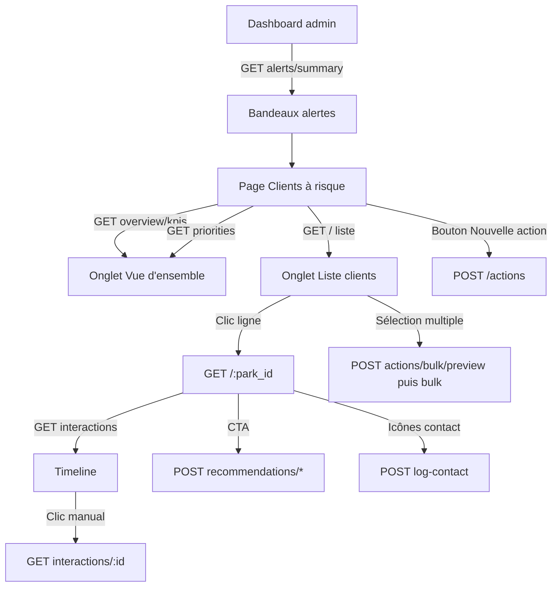

# API Clients à risque — Guide d'intégration frontend

Guide pratique pour consommer le module **Clients à risque** depuis l'admin VTCControl.

> Spécification fonctionnelle complète (maquettes Figma, scoring, modèle de données) : [`README-CLIENTS-A-RISQUE.md`](./README-CLIENTS-A-RISQUE.md)

---

## Sommaire

1. [Démarrage rapide](#1-démarrage-rapide)
2. [Permissions](#2-permissions)
3. [Filtres communs](#3-filtres-communs)
4. [Index des routes](#4-index-des-routes)
5. [Vue d'ensemble & liste](#5-vue-densemble--liste)
6. [Fiche client](#6-fiche-client)
7. [Interactions & timeline](#7-interactions--timeline)
8. [Actions CRM](#8-actions-crm)
9. [Notes, override & chargé de compte](#9-notes-override--chargé-de-compte)
10. [Référence des enums](#10-référence-des-enums)
11. [Types TypeScript](#11-types-typescript)
12. [Flux d'écrans recommandés](#12-flux-décrans-recommandés)
13. [Erreurs & pièges](#13-erreurs--pièges)

---

## 1. Démarrage rapide

### Base URL

```
{API_BASE}/admin/clients-at-risk
```

Exemple local : `http://localhost:8001/admin/clients-at-risk`

### Authentification

Toutes les routes exigent un profil **ROOT** (admin plateforme).

| Header | Valeur |
|--------|--------|
| `Authorization` | `Bearer {token}` — obtenu via `POST /login-root` |
| `profile_id` | UUID du profil ROOT connecté |
| `Content-Type` | `application/json` (POST / PATCH / PUT) |

**Exemple login :**

```bash
curl -X POST "$API_BASE/login-root" \
  -H "Content-Type: application/json" \
  -d '{"email":"...","password":"..."}'
```

Réponse : `data.token` + `data.id` (profile_id).

**Exemple appel :**

```bash
curl "$API_BASE/admin/clients-at-risk/overview/kpis" \
  -H "Authorization: Bearer $TOKEN" \
  -H "profile_id: $PROFILE_ID"
```

### Enveloppe de réponse

Toutes les routes renvoient le format standard VTCControl :

```json
{
  "code": 5000,
  "message": "Success",
  "data": { }
}
```

| Code | Signification |
|------|---------------|
| `5000` | Succès |
| `5005` | Token / `profile_id` manquant |
| `5007` | Non autorisé (pas ROOT ou permission insuffisante) |
| `404`  | Ressource introuvable |
| Erreur validation | Message explicite dans `message` |

Les exemples ci-dessous montrent uniquement le contenu de **`data`**.

### Pagination

Paramètres communs :

| Paramètre | Défaut | Description |
|-----------|--------|-------------|
| `page` | `1` | Page courante (≥ 1) |
| `itemPerPage` | `10` | Taille de page |

Réponse paginée type :

```json
{
  "data": [ ],
  "totalRecords": 42,
  "totalPages": 5,
  "currentPage": 1,
  "itemPerPage": 10
}
```

**Plafond liste principale :** `itemPerPage` max **500** sur `GET /admin/clients-at-risk`.

### Tableaux en query string

Pour les filtres multi-valeurs (ex. `alert_signal`) :

```
GET /admin/clients-at-risk?alert_signal=no_recent_payment&alert_signal=expired&risk_level=high
```

---

## 2. Permissions

| Permission catalogue | Routes |
|---------------------|--------|
| `clients_at_risk.read` | Tous les `GET` |
| `clients_at_risk.manage_actions` | Tous les `POST`, `PATCH`, `PUT` |

- Rôle requis : **ROOT** uniquement.
- **Périmètre ville** : si le profil ROOT a des villes assignées (`rootProfileCity`), seuls les parcs de ces villes sont visibles. Sans restriction ville → accès global.

---

## 3. Filtres communs

Disponibles sur la plupart des routes `GET` (query params) :

| Paramètre | Type | Description |
|-----------|------|-------------|
| `city_id` | number | Filtre par ville du parc |
| `country_id` | number | Filtre par pays |
| `currency_id` | number | Filtre par devise |
| `account_type` | string | `particulier` \| `professionnel` |
| `start_date` | ISO date | Début de période |
| `end_date` | ISO date | Fin de période |

---

## 4. Index des routes

| Méthode | Route | Permission | Usage écran |
|---------|-------|------------|-------------|
| `GET` | `/alerts/summary` | read | Bandeaux dashboard |
| `GET` | `/overview/kpis` | read | 6 cartes KPI |
| `GET` | `/priorities` | read | Table priorités du jour |
| `GET` | `/` | read | Liste clients (+ export front) |
| `GET` | `/meta/assignees` | read | Dropdown responsable |
| `GET` | `/actions` | read | Liste actions / KPI relances |
| `POST` | `/actions` | manage | Nouvelle action / relance |
| `GET` | `/actions/:id` | read | Édition brouillon |
| `PATCH` | `/actions/:id` | manage | Mise à jour action |
| `POST` | `/actions/bulk/preview` | manage | Preview relance groupée |
| `POST` | `/actions/bulk` | manage | Relance multi-clients |
| `GET` | `/:park_id` | read | Fiche détail client |
| `GET` | `/:park_id/interactions` | read | Timeline interactions |
| `GET` | `/:park_id/interactions/:interaction_id` | read | Drawer détail interaction |
| `POST` | `/:park_id/interactions` | manage | Créer interaction complète |
| `PATCH` | `/:park_id/interactions/:interaction_id` | manage | Modifier interaction |
| `POST` | `/:park_id/log-contact` | manage | Contact rapide (tél / email / sms) |
| `POST` | `/:park_id/recommendations/send-payment-plan` | manage | CTA échéancier |
| `POST` | `/:park_id/recommendations/register-follow-up` | manage | CTA relance J+2 |
| `POST` | `/:park_id/recommendations/schedule-review` | manage | CTA revue de compte |
| `GET` | `/:park_id/notes` | read | Notes internes |
| `POST` | `/:park_id/notes` | manage | Ajouter une note |
| `GET` | `/:park_id/override` | read | Override scoring CRM |
| `PUT` | `/:park_id/override` | manage | Modifier override |
| `PUT` | `/:park_id/account-manager` | manage | Assigner chargé de compte |

**Hors scope API :** `GET /export`, `POST /:park_id/send-email` (v2). L'export CSV/PDF est géré côté front via la liste paginée.

---

## 5. Vue d'ensemble & liste

### `GET /alerts/summary`

Bandeaux orange / rouge du dashboard admin.

**Réponse `data` :**

```json
{
  "expiring_subscriptions": {
    "count": 3,
    "threshold_days": 7,
    "preview": [
      { "park_id": "uuid", "fleet_name": "TransportPro SA" }
    ]
  },
  "inactive_fleets": {
    "count": 5,
    "threshold_days": 30,
    "preview": [
      { "park_id": "uuid", "fleet_name": "CarGo Express" }
    ]
  }
}
```

`preview` = 3 premières flottes (noms pour affichage rapide). « Voir les détails » peut aussi utiliser les routes dashboard existantes :
- `GET /admin-dashboard/expiring-subscriptions`
- `GET /admin-dashboard/inactive-fleets?min_inactive_days=30`

---

### `GET /overview/kpis`

6 cartes de la vue d'ensemble.

**Réponse `data` — une clé par carte :**

| Clé API | Carte UI |
|---------|----------|
| `discount_requests` | Demandes de remise |
| `training_required` | Formation requise |
| `financial_difficulties` | Difficultés financières |
| `pending_follow_ups` | Relances en attente |
| `subscription_changes` | Changements d'abonnement |
| `renewal_opportunities` | Opportunités de renouvellement |

Structure de chaque carte :

```json
{
  "count": 12,
  "trend_week": {
    "current": 12,
    "previous": 8,
    "percent_change": 50
  }
}
```

`percent_change` : variation semaine courante vs semaine précédente (afficher flèche hausse / baisse / stable).

---

### `GET /priorities`

Top clients par score de risque.

| Query | Défaut | Description |
|-------|--------|-------------|
| `limit` | `5` | Nombre de lignes |

**Item `data[]` :**

```json
{
  "rank": 1,
  "park_id": "uuid",
  "client_name": "Transports Kouassi & Fils",
  "city": "Abidjan",
  "vehicle_count": 42,
  "alert_signal": "no_recent_payment",
  "alert_label": "Aucun paiement récent",
  "main_problem": "Facture impayée depuis 21 jours",
  "risk_score": 72,
  "risk_level": "high"
}
```

Actions rapides (téléphone, email, fiche) : utiliser `park_id` → `GET /:park_id` ou `POST /:park_id/log-contact`.

---

### `GET /` — Liste paginée

Route principale de l'onglet « Liste des clients ».

#### Query spécifiques

| Paramètre | Type | Description |
|-----------|------|-------------|
| `search` | string | Nom flotte, ville, propriétaire |
| `alert_signal` | string[] | Voir [signaux](#alert_signal) |
| `risk_level` | string[] | `high`, `medium`, `low` |
| `risk_score_min` | number | Score min (0–100) |
| `risk_score_max` | number | Score max |
| `subscription_plan` | string | Nom ou code plan |
| `account_manager_id` | string | UUID profil chargé de compte |
| `group_by` | string | Voir ci-dessous |
| `sort_by` | string | `risk_score` (défaut), `last_activity`, `last_contact`, `next_action_date` |
| `sort_order` | string | `asc` \| `desc` (défaut `desc` sur `risk_score`) |

#### `group_by`

| Valeur | Regroupement |
|--------|--------------|
| `none` ou absent | Liste plate paginée |
| `risk_level` | Par niveau de risque |
| `risk_cause` | Par signal d'alerte |
| `client_need` | Par besoin client |
| `account_manager` | Par chargé de compte |

**Sans regroupement** — `data` :

```json
{
  "data": [ /* ClientAtRiskListItem[] */ ],
  "totalRecords": 16,
  "totalPages": 2,
  "currentPage": 1,
  "itemPerPage": 10,
  "filtered_count_label": "16 clients"
}
```

**Avec regroupement** — `data` :

```json
{
  "groups": [
    {
      "group_key": "high",
      "group_label": "Risque élevé",
      "count": 8,
      "items": [ /* ClientAtRiskListItem[] */ ]
    }
  ],
  "totalRecords": 4,
  "totalPages": 1,
  "currentPage": 1,
  "itemPerPage": 10
}
```

> Avec `group_by`, `totalRecords` = nombre de **groupes**, pas de clients.

#### Item liste (`ClientAtRiskListItem`)

Champs clés pour le tableau :

```json
{
  "park_id": "uuid",
  "name": "Transports Kouassi & Fils",
  "logo": "https://...",
  "city": "Abidjan",
  "country": "Côte d'Ivoire",
  "vehicle_count": 42,
  "vehicle_count_label": "42 véh.",
  "plan_name": "Essentiel",
  "renewal_in_days": 17,
  "expired_days_ago": null,
  "renewal_label": "Renouv. dans 17j",
  "end_date": "2026-06-18T00:00:00.000Z",
  "subscription_status": "active",
  "alert_signal": "no_recent_payment",
  "alert_label": "Aucun paiement récent",
  "risk_score": 72,
  "risk_level": "high",
  "risk_score_tier": "critical",
  "main_problem": "Facture impayée depuis 21 jours",
  "client_need": "payment_plan",
  "client_need_label": "Échéancier de paiement",
  "last_activity_at": "2026-06-06T14:30:00.000Z",
  "last_contact_at": "2026-05-20T09:00:00.000Z",
  "last_contact_type": "call",
  "next_action": {
    "id": "uuid",
    "type": "follow_up",
    "label": "Relance client",
    "display_label": "Relance client - 03 juin 2026",
    "scheduled_at": "2026-06-03T10:00:00.000Z",
    "assignee": {
      "profile_id": "uuid",
      "first_name": "Aya",
      "last_name": "Koné"
    }
  },
  "account_manager_id": "uuid"
}
```

**Export front :** itérer les pages ou `itemPerPage=500`. Pas de route `/export`.

---

### `GET /meta/assignees`

Liste des profils ROOT éligibles comme **Responsable** (dropdown actions).

| Query | Description |
|-------|-------------|
| `city_id` | Optionnel — restreindre à une ville |

**Réponse `data` :** tableau direct (pas de pagination)

```json
[
  {
    "profile_id": "uuid",
    "first_name": "Serge",
    "last_name": "Kouassi",
    "avatar_url": null
  }
]
```

---

## 6. Fiche client

### `GET /:park_id`

Fiche complète (écran détail). Retourne `null` + code 404 si parc hors périmètre.

**Blocs principaux dans `data` :**

| Bloc | Usage UI |
|------|----------|
| `badges` | Pastilles risque + signal principal |
| `risk_analysis` | Score, tendance 30j, sparkline, facteurs |
| `recommendations[]` | 3 cartes CTA avec `cta_action` |
| `primary_contact` | Contact propriétaire |
| `fleet` | Taille flotte + palier |
| `subscription` | Plan, montant, renouvellement |
| `account_manager` | Chargé de compte assigné |
| `recent_payments_summary` | Dernier paiement OK / échoué |

**Recommandations → routes CTA :**

| `cta_action` | Route à appeler |
|--------------|-----------------|
| `send_payment_plan` | `POST /:park_id/recommendations/send-payment-plan` |
| `register_follow_up` | `POST /:park_id/recommendations/register-follow-up` |
| `schedule_account_review` | `POST /:park_id/recommendations/schedule-review` |

---

## 7. Interactions & timeline

### `GET /:park_id/interactions`

Timeline paginée (actions manuelles + événements système).

| Query | Description |
|-------|-------------|
| `type` | `manual` \| `system` \| `all` |
| `status` | `draft`, `todo`, `in_progress`, `completed`, `cancelled` |
| `page`, `itemPerPage` | Pagination |

**Item liste :**

```json
{
  "id": "uuid",
  "source": "manual",
  "category": "payment_overdue",
  "category_label": "Paiement en retard",
  "title": "Appel de relance",
  "occurred_at": "2024-05-12T00:00:00.000Z",
  "notes": "Client joignable demain",
  "tags": [
    { "type": "contact_type", "label": "Appel" },
    { "type": "assignee", "label": "Aya Koné", "profile_id": "uuid" }
  ],
  "status": "todo",
  "status_label": "À faire",
  "priority": "high",
  "priority_label": "Haute",
  "deadline_at": "2024-06-05T00:00:00.000Z",
  "assignee": { "profile_id": "uuid", "first_name": "Aya", "last_name": "Koné" }
}
```

- `source=manual` → clic ouvre le drawer via `GET .../interactions/:id`
- `source=system` → lecture seule (paiements, abonnements…)

---

### `GET /:park_id/interactions/:interaction_id`

Détail drawer « Détails de l'interaction ».

Champs importants : `editable` (false pour système), `communication_channel`, `contact_reason`, `exchange_summary`, `identified_needs`, `proposed_solution`, `result`, `next_steps`, `assigned_to`, `header` (contexte client).

---

### `POST /:park_id/interactions`

Créer une interaction complète (drawer « Enregistrer une interaction »).

```json
{
  "mode": "register_interaction",
  "title": "Appel de suivi facture",
  "description": "Discussion sur l'échéancier",
  "communication_channel": "call",
  "contact_reason": "payment_overdue",
  "exchange_summary": "Le client accepte un échéancier sur 3 mois",
  "identified_needs": ["payment_plan"],
  "proposed_solution": "Échéancier 3x",
  "result": "positive",
  "next_steps": "Envoyer le contrat signé",
  "assigned_to_profile_id": "uuid",
  "next_follow_up_at": "2026-06-10T00:00:00.000Z",
  "occurred_at": "2026-06-08T14:00:00.000Z"
}
```

> **`result` est obligatoire** quand `mode=register_interaction`.

---

### `PATCH /:park_id/interactions/:interaction_id`

Même champs que `PATCH /actions/:id` (statut, compte rendu, résultat…).

---

### `POST /:park_id/log-contact`

Raccourci depuis les icônes téléphone / email / SMS.

```json
{
  "type": "call",
  "notes": "Pas de réponse, message vocal laissé"
}
```

`type` : `call` | `email` | `sms`

Crée une action et met à jour `last_contact_at` / `last_contact_type` sur la liste.

---

## 8. Actions CRM

### `POST /actions` — Nouvelle action

Deux modes principaux :

#### Planifier une relance (`schedule_follow_up` — défaut)

```json
{
  "mode": "schedule_follow_up",
  "park_id": "uuid",
  "action_type": "follow_up_client",
  "description": "Relancer le client sur l'échéancier",
  "assigned_to_profile_id": "uuid",
  "deadline_at": "2026-06-03T00:00:00.000Z",
  "priority": "medium",
  "status": "in_progress"
}
```

#### Brouillon

```json
{
  "mode": "schedule_follow_up",
  "park_id": "uuid",
  "description": "...",
  "status": "draft"
}
```

**Réponse `data` :**

```json
{
  "id": "uuid",
  "summary_label": "Prochaine relance programmée le 03 juin 2026, assignée à Serge Kouassi.",
  "deadline_at": "2026-06-03T00:00:00.000Z",
  "assignee": {
    "profile_id": "uuid",
    "first_name": "Serge",
    "last_name": "Kouassi"
  }
}
```

Afficher `summary_label` dans l'encadré de confirmation bleu.

---

### `GET /actions/:id`

Charge une action pour édition (brouillon ou relance existante). Retourne l'objet Prisma enrichi (assigné, créateur…).

---

### `PATCH /actions/:id`

```json
{
  "status": "completed",
  "description": "Client a accepté l'échéancier",
  "completed_at": "2024-06-03T11:30:00.000Z"
}
```

Passer `status: "completed"` déclenche automatiquement `completed_at` si non fourni.

---

### `GET /actions`

Liste globale des actions (KPI relances, vue tâches).

| Query | Description |
|-------|-------------|
| `status` | Filtrer par statut |
| `park_id` | Filtrer par parc |
| `assigned_to_profile_id` | Filtrer par responsable |
| `page`, `itemPerPage` | Pagination |

---

### Relance groupée (multi-clients)

#### `POST /actions/bulk/preview`

Valide la sélection avant création.

```json
{
  "park_ids": ["uuid1", "uuid2", "uuid3"],
  "description": "Relance échéancier",
  "assigned_to_profile_id": "uuid",
  "deadline_at": "2026-06-03T00:00:00.000Z",
  "group_label": "Groupe : Factures impayées > 30 jours",
  "group_key": "unpaid_invoice_30d",
  "group_by": "risk_cause"
}
```

**Réponse `data` :**

```json
{
  "park_count": 15,
  "summary_label": "Prochaine relance programmée le 03 juin 2026 pour 15 clients, assignée à Serge Kouassi.",
  "deadline_at": "2026-06-03T00:00:00.000Z",
  "assignee": { "profile_id": "uuid", "first_name": "Serge", "last_name": "Kouassi" },
  "group_label": "Groupe : Factures impayées > 30 jours"
}
```

#### `POST /actions/bulk`

Même body + création effective.

**Réponse `data` :**

```json
{
  "created_count": 15,
  "failed_count": 1,
  "bulk_group_id": "uuid",
  "summary_label": "...",
  "action_ids": ["uuid1", "uuid2"],
  "assignee": { "profile_id": "uuid", "first_name": "Serge", "last_name": "Kouassi" },
  "failed_park_ids": ["uuid-hors-perimetre"]
}
```

---

### CTA recommandations (fiche client)

Body optionnel commun :

```json
{
  "assigned_to_profile_id": "uuid",
  "notes": "Contexte additionnel"
}
```

| Route | Effet métier |
|-------|--------------|
| `POST /:park_id/recommendations/send-payment-plan` | Action « Échéancier de paiement », priorité haute |
| `POST /:park_id/recommendations/register-follow-up` | Relance planifiée à **J+2** |
| `POST /:park_id/recommendations/schedule-review` | Revue de compte planifiée à **J+7** |

Réponse identique à `POST /actions` (`ClientAtRiskActionCreateResponse`).

> L'envoi email automatique de l'échéancier n'est pas encore branché (v2).

---

## 9. Notes, override & chargé de compte

### `GET /:park_id/notes` — `POST /:park_id/notes`

Notes internes CRM sur un parc.

**POST body :**

```json
{ "content": "Client sensible — toujours appeler le DG en premier." }
```

**Item note :**

```json
{
  "id": "uuid",
  "park_id": "uuid",
  "content": "...",
  "created_at": "2026-06-01T10:00:00.000Z",
  "author": {
    "profile_id": "uuid",
    "first_name": "Aya",
    "last_name": "Koné",
    "avatar_url": null
  }
}
```

---

### `GET /:park_id/override` — `PUT /:park_id/override`

Ajustement manuel du scoring / signaux par les admins.

**PUT body :**

```json
{
  "alert_signal": "no_recent_payment",
  "client_need": "payment_plan",
  "risk_score_adjustment": 10
}
```

Mettre `null` sur un champ pour le supprimer.

---

### `PUT /:park_id/account-manager`

```json
{ "profile_id": "uuid-du-charge-de-compte" }
```

**Réponse `data` :**

```json
{
  "park_id": "uuid",
  "profile_id": "uuid",
  "first_name": "Aya",
  "last_name": "Koné",
  "assigned_at": "2026-06-08T12:00:00.000Z"
}
```

---

## 10. Référence des enums

### `alert_signal` {#alert_signal}

| Valeur | Libellé UI |
|--------|------------|
| `no_recent_payment` | Aucun paiement récent |
| `expired` | Expiré |
| `expiring_soon` | Expire bientôt |
| `inactive` | Inactif |
| `low_activity` | Faible activité |
| `payment_failed` | Paiement refusé |

### `risk_level`

| Valeur | Seuil score | Libellé |
|--------|-------------|---------|
| `high` | ≥ 70 | Risque élevé |
| `medium` | ≥ 40 | Risque modéré |
| `low` | < 40 | Risque faible |

### `client_need`

| Valeur | Libellé |
|--------|---------|
| `payment_plan` | Échéancier de paiement |
| `training` | Session de formation |
| `loyalty_discount` | Remise fidélité |
| `renewal_call` | Appel de renouvellement |
| `account_review` | Revue de compte |
| `renewal` | Renouvellement |
| `billing_review` | Revue facturation |

### Statuts action `status`

| Valeur | Libellé | Note |
|--------|---------|------|
| `draft` | Brouillon | |
| `todo` | À faire | `pending` accepté en entrée → mappé vers `todo` |
| `in_progress` | En cours | |
| `completed` | Terminé | Libellé Figma « Réalisée » |
| `cancelled` | Annulé | |

### Priorités `priority`

`low` | `medium` | `high` | `urgent`

### `action_type`

`follow_up_client` | `send_promotion` | `schedule_demo` | `account_review` | `training_session` | `technical_intervention`

### Canaux `communication_channel`

`call` | `email` | `sms` | `whatsapp` | `meeting` | `other`

### Motifs contact `contact_reason`

`payment_overdue` | `subscription_renewal` | `training` | `account_review` | `other`

### Résultat interaction `result`

`positive` | `neutral` | `negative` | `pending` | `no_answer`

### Modes création `mode`

| Valeur | Usage |
|--------|-------|
| `schedule_follow_up` | Planifier une relance (défaut) |
| `register_interaction` | Enregistrer un contact passé (`result` requis) |

---

## 11. Types TypeScript

Types de réponses partagés côté API (à reproduire ou importer si monorepo) :

| Fichier | Contenu |
|---------|---------|
| [`app/types/clientAtRiskType.ts`](app/types/clientAtRiskType.ts) | Toutes les interfaces de réponse |
| [`app/types/paginatorType.ts`](app/types/paginatorType.ts) | Queries TSOA (`clientsAtRiskListQueries`, etc.) |
| [`app/models/clientRiskAction.ts`](app/models/clientRiskAction.ts) | Enums actions CRM |

Exemple typage front :

```typescript
interface ApiEnvelope<T> {
  code: number;
  message: string;
  data: T;
}

type ClientListResponse = ApiEnvelope<{
  data: ClientAtRiskListItem[];
  totalRecords: number;
  totalPages: number;
  currentPage: number;
  itemPerPage: number;
  filtered_count_label: string;
}>;
```

---

## 12. Flux d'écrans recommandés



**Ordre de chargement fiche client :**

1. `GET /:park_id` — colonne gauche + recommandations
2. `GET /:park_id/interactions?page=1` — timeline
3. `GET /:park_id/notes?page=1` — panneau notes (si onglet séparé)
4. `GET /:park_id/override` — si panneau admin scoring

---

## 13. Erreurs & pièges

| Situation | Comportement |
|-----------|--------------|
| Parc hors ville assignée | `404` « Parc introuvable » |
| Permission `manage_actions` manquante | `5007` sur POST/PATCH/PUT |
| `register_interaction` sans `result` | Erreur validation |
| `bulk` avec `park_ids` vide | Erreur validation |
| `group_by` actif | Pagination sur les **groupes**, pas les clients |
| `GET /actions/:id` sur id inconnu | `404` |
| Override inexistant | `GET override` → `data: null` (succès) |

### Script de test HTTP

Un script de smoke test est disponible :

```bash
./app/scripts/test-clients-at-risk-http.sh
```

Prérequis : `ROOT_EMAIL` et `ROOT_PASSWORD` dans `.env`, serveur démarré.

### Routes dashboard complémentaires

Pour les modales « Voir tout » avec pagination complète (hors module clients à risque) :

| Route | Usage |
|-------|-------|
| `GET /admin-dashboard/expiring-subscriptions` | Liste complète abos expirants |
| `GET /admin-dashboard/inactive-fleets?min_inactive_days=30` | Liste complète flottes inactives |

---

*Dernière mise à jour : aligné sur `AdminClientsAtRiskController` — namespace `/admin/clients-at-risk`.*